# SisterHood — Complete Technical Deep-Dive

**Feature Summary**: SisterHood is a real-time women's safety shield built on top of Google Maps, Firebase Realtime Database (RTDB), and background location services. It provides continuous geohash-based area monitoring, an SOS broadcast system visible to nearby users, voice-triggered emergency activation, trust-weighted block safety scoring, and persistent Android notification controls — all running even when the app is in the background.

---

## Table of Contents

1. [Architecture Overview](#1-architecture-overview)
2. [Folder Structure](#2-folder-structure)
3. [Entry Point: index.jsx](#3-entry-point-indexjsx)
4. [Location Permission Gate: LocationAccess.jsx](#4-location-permission-gate-locationaccessjsx)
5. [Core Engine: SisterHoodMap.jsx](#5-core-engine-sisterhoodmapjsx)
6. [Geohash Block System](#6-geohash-block-system)
7. [RTDB Data Model](#7-rtdb-data-model)
8. [SOS Lifecycle](#8-sos-lifecycle)
9. [Trust Score System](#9-trust-score-system)
10. [Block Safety Score (Reverse Gaussian Model)](#10-block-safety-score-reverse-gaussian-model)
11. [Background Service Architecture](#11-background-service-architecture)
12. [Notification Actions System](#12-notification-actions-system)
13. [Voice and Hardware Triggers](#13-voice-and-hardware-triggers)
14. [SOSBottomBar Component](#14-sosbottombar-component)
15. [SOSResolutionModal Component](#15-sosresolutionmodal-component)
16. [Compass and Map Rendering](#16-compass-and-map-rendering)
17. [Graceful Exit System](#17-graceful-exit-system)
18. [Safety Agent (Python Backend)](#18-safety-agent-python-backend)
19. [Backend API Endpoints](#19-backend-api-endpoints)
20. [Complete Data Flow Diagrams](#20-complete-data-flow-diagrams)

---

## 1. Architecture Overview

```mermaid
graph TB
    subgraph Client["React Native Client (Expo)"]
        GATE["index.jsx<br>Permission Gateway"]
        MAP["SisterHoodMap.jsx<br>Core Engine (1106 lines)"]
        SOS_BAR["SOSBottomBar.jsx<br>UI Controls"]
        RES_MODAL["SOSResolutionModal.jsx<br>Post-SOS Classification"]
    end

    subgraph Utils["_utils/ (14 utility files)"]
        LOC_MATH["locationMath.js<br>Haversine + Bearing"]
        STAT_MGR["stationaryManager.js<br>50m Radius Blocks"]
        WIN_MGR["windowManager.js<br>Sliding Window FSM"]
        RTDB_ADD["Rtdbadd.js<br>Block Registration"]
        RTDB_DEL["Rtdbdel.js<br>Block Cleanup"]
        BG_SVC["backgroundService.js<br>Background Location"]
        NOTIF["notificationActions.js<br>Android Notifications"]
        VOL_TRIG["volumeTrigger.js<br>Hardware Button SOS"]
        COMPASS["useCompass.js<br>60fps Heading"]
        TRUST_MGR["trustScoreManager.js<br>Trust Math"]
        USE_TRUST["useTrustScore.js<br>Trust Hook"]
        SAFETY_SCORE["useSafetyScore.js<br>Block Score Hook"]
        GRACEFUL["useGracefulExit.js<br>Cleanup on Exit"]
        ADD_USER["addUserToRTDB.js<br>User Registration"]
        STATIONARY["stationaryManager.js"]
    end

    subgraph Firebase["Firebase"]
        RTDB_BLOCKS["RTDB: /blocks/{geohash8}"]
        RTDB_USERS["RTDB: /users/{userId}"]
        RTDB_SOS["RTDB: /active_sos/{geo6}/{userId}"]
    end

    subgraph Server["Express Server"]
        BLOCK_FETCH["/api/blocks/fetch"]
        BLOCK_UPDATE["/api/blocks/update"]
        EXIT_FLUSH["/api/user/sisterhood-exit"]
        VOICE_UP["/api/voice/upload"]
    end

    subgraph Python["Python Agent"]
        SAFETY_AI["safety_agent.py<br>LangGraph Safety Auditor"]
    end

    GATE -->|Permission Granted| MAP
    MAP --> SOS_BAR
    MAP --> RES_MODAL
    MAP --> LOC_MATH
    MAP --> STAT_MGR
    MAP --> WIN_MGR
    MAP --> RTDB_ADD
    MAP --> RTDB_DEL
    MAP --> BG_SVC
    MAP --> COMPASS
    MAP --> TRUST_MGR
    MAP --> USE_TRUST
    MAP --> SAFETY_SCORE
    MAP --> GRACEFUL
    MAP --> VOL_TRIG
    SOS_BAR --> NOTIF

    RTDB_ADD --> RTDB_BLOCKS
    RTDB_ADD --> BLOCK_FETCH
    RTDB_DEL --> RTDB_BLOCKS
    RTDB_DEL --> BLOCK_UPDATE
    MAP --> RTDB_USERS
    MAP --> RTDB_SOS
    USE_TRUST --> EXIT_FLUSH
    SOS_BAR --> VOICE_UP
```

---

## 2. Folder Structure

```
SisterHood/
  index.jsx                    -- Permission gateway (79 lines)
  LocationAccess.jsx           -- Permission request UI (69 lines)
  SisterHoodMap.jsx            -- Core map + tracking engine (1106 lines)
  _components/
    SOSBottomBar.jsx           -- SOS button + record + call UI (513 lines)
    SOSResolutionModal.jsx     -- Post-SOS false alarm/real emergency modal (157 lines)
  _models/
    RTDB/                      -- Firebase RTDB schema definitions
    firestore/                 -- Firestore schema definitions
  _utils/
    backgroundService.js       -- Background location tracking (201 lines)
    notificationActions.js     -- Persistent notification with action buttons (249 lines)
    locationMath.js            -- Haversine distance, bearing, destination point (53 lines)
    stationaryManager.js       -- 50m radius geohash8 block initialization (24 lines)
    windowManager.js           -- Sliding window algorithm for moving state (84 lines)
    Rtdbadd.js                 -- Atomic block registration in RTDB (103 lines)
    Rtdbdel.js                 -- Atomic block removal + Firestore writeback (52 lines)
    trustScoreManager.js       -- Pure math for trust score lifecycle (130 lines)
    useTrustScore.js           -- React hook wrapping trust operations (119 lines)
    useSafetyScore.js          -- Real-time block safety score listener (45 lines)
    useCompass.js              -- Hardware-accelerated compass heading (71 lines)
    useGracefulExit.js         -- RTDB cleanup + navigation on exit (102 lines)
    volumeTrigger.js           -- Hardware volume button SOS trigger (73 lines)
    Rtdbadd.js                 -- User presence management
    addUserToRTDB.js           -- User node initialization
```

**Why this structure?** Every utility file is a single-responsibility module. This prevents the 1106-line SisterHoodMap.jsx from becoming even larger. The `_utils/` prefix with underscore signals these are internal, non-routable modules in Expo Router.

---

## 3. Entry Point: index.jsx

**File**: `SisterHood/index.jsx` (79 lines)

**Purpose**: Acts as a permission gateway. Before any safety feature runs, we need location access.

**Logic Flow**:

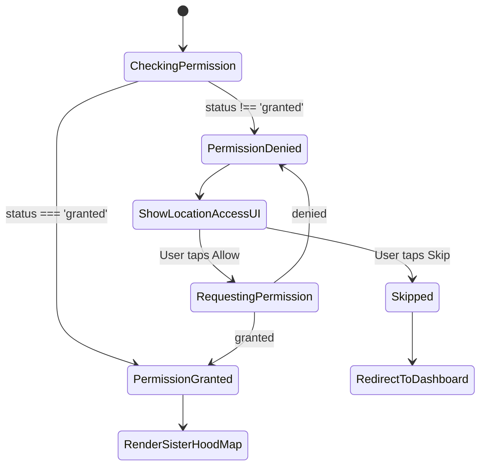

**Key Decisions**:
- Uses `null` as the initial state to show a loading spinner while checking permissions (prevents UI flash)
- `hasPermission === 'skipped'` uses Expo Router's `<Redirect>` to navigate away — this is a clean declarative redirect rather than an imperative `router.replace()`
- The `requestPermission` function wraps `Location.requestForegroundPermissionsAsync()` with proper error handling and user-facing alerts

---

## 4. Location Permission Gate: LocationAccess.jsx

**File**: `SisterHood/LocationAccess.jsx` (69 lines)

**Purpose**: A polished full-screen UI asking the user for location permission. Explains *why* the app needs location data.

**Key UI Elements**:
- MapPin icon in a circular container
- "Enable Location" heading with explanation text
- Privacy Note box: "Your location is encrypted and only shared with emergency contacts when you trigger an SOS"
- "Allow Access" button (white, primary CTA) with loading state
- "Skip for now" secondary text button

**Why a separate component?** This keeps the permission request UI decoupled from the main map logic. If you ever need to reuse the same permission pattern for other features (StreetGig already does), you change one file.

---

## 5. Core Engine: SisterHoodMap.jsx

**File**: `SisterHood/SisterHoodMap.jsx` (1106 lines)

This is the brain of SisterHood. It manages:
1. Real-time GPS tracking (foreground + background)
2. A **Stationary/Moving finite state machine** for geohash block management
3. SOS activation/deactivation lifecycle
4. Nearby threat detection via RTDB listeners
5. Trust-weighted block safety impact scoring
6. Background service coordination
7. Map rendering with custom dark theme

### State Variables

| Variable | Type | Purpose |
|---|---|---|
| `currentLocation` | `{latitude, longitude}` | Latest GPS coordinates |
| `trackingMode` | `'STATIONARY' \| 'MOVING'` | Current FSM state |
| `sosActive` | `boolean` | Whether SOS is currently broadcasting |
| `isRecording` | `boolean` | Whether voice recording is active |
| `nearbyThreats` | `Array<{id, lat, lng, picture, distance}>` | Other users with active SOS nearby |
| `currentGeo8` | `string` | Current geohash8 block (drives safety score hook) |
| `focusedThreat` | `object` | Closest threat for the alert banner |
| `showSOSBanner` | `boolean` | Whether the nearby-SOS alert banner is visible |
| `showResolutionModal` | `boolean` | Whether the post-SOS outcome modal is shown |

### Ref Variables (Performance Critical)

| Ref | Purpose |
|---|---|
| `mapRef` | Google Maps instance for camera control |
| `animatedLocRef` | `AnimatedRegion` for smooth marker transitions |
| `modeRef` | Mirrors `trackingMode` without re-render overhead |
| `blocksRef` | Active geohash8 blocks (avoids state overhead) |
| `anchorRef` | Starting position for stationary-to-moving distance check |
| `lastCoordRef` | Previous GPS coords for bearing calculation |
| `bearingRef` | Current walking direction in degrees |
| `lastGeo8Ref` / `lastGeo6Ref` | Previous geohash values (change detection) |
| `sosActiveRef` | Mirrors `sosActive` for use in callbacks without stale closures |
| `isProcessingRef` | Prevents re-entrant location processing |
| `isInBackground` | Tracks foreground/background state |
| `isTransitioningRef` | Prevents duplicate transition handling |
| `sosWasTriggeredRef` | Tracks if SOS was ever triggered this session (for resolution modal) |

**Why use refs instead of state?** State updates in React cause re-renders. Location updates arrive every 2 seconds. If every GPS tick triggered a full re-render of the map + all markers + all listeners, the app would be unusable. Refs update synchronously without causing renders — critical for a 60fps map experience.

### The Main Location Worker: handleLocationWorker()

This function runs on every GPS update (~every 2 seconds). It is the heart of the system:

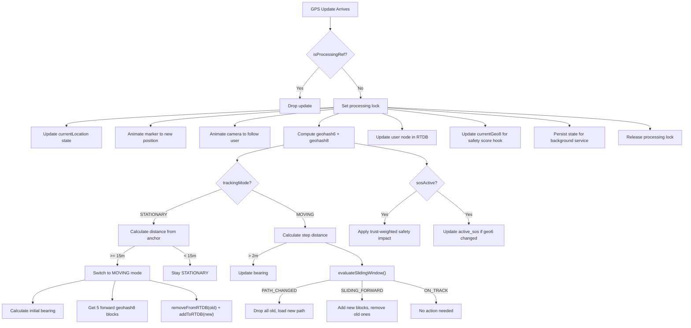

---

## 6. Geohash Block System

### What is a Geohash?

A geohash is a string that encodes a latitude/longitude into a compact grid cell. The longer the string, the smaller the cell:

| Precision | Cell Size | Use in SisterHood |
|---|---|---|
| 6 characters | ~1.2km x 0.6km | SOS broadcast radius (active_sos key) |
| 8 characters | ~38m x 19m | Block-level safety scoring + user tracking |

### Why Geohash?

1. **Prefix matching**: All blocks starting with `tdr9xw` are in the same 1.2km region — enables fast "nearby" queries
2. **Deterministic**: Same GPS always maps to the same block — no ambiguity
3. **Hierarchical**: geo8 `tdr9xwab` is always inside geo6 `tdr9xw` — free containment checks
4. **Firebase-friendly**: Geohash strings work perfectly as Firebase RTDB keys

### Stationary State

When the user first enters SisterHood, they are in `STATIONARY` mode:

**File**: `stationaryManager.js`

```javascript
getInitialStationaryBlocks(lat, lng, radiusInMeters = 50)
```

This function:
1. Computes a bounding box of `radiusInMeters` around the user's position
2. Uses `ngeohash.bboxes()` to get ALL geohash8 cells that overlap this bounding box
3. Filters out cells whose center is > 60m away (radius + 10m tolerance)
4. Returns typically 6-12 blocks covering a 50m radius

These blocks are registered in RTDB so the safety score of the user's immediate area is tracked.

### Moving State + Sliding Window

When the user walks 15+ meters from their anchor point, the system switches to `MOVING`:

**File**: `windowManager.js`

```javascript
getForwardBlocks(startLat, startLng, bearing, blockCount = 5)
```

This projects 5 geohash8 blocks forward along the user's bearing (walking direction). Each projection step is 30 meters — roughly one geohash8 cell width.

**evaluateSlidingWindow()** handles three scenarios:

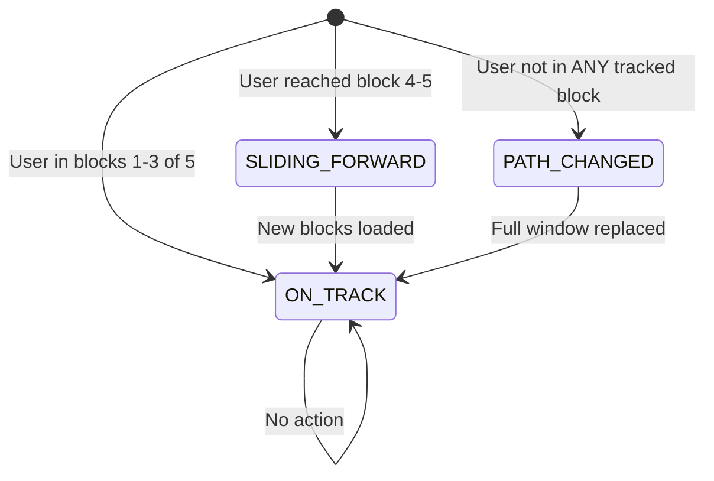

- **ON_TRACK**: User is within the first 3 of 5 tracked blocks. No action needed.
- **SLIDING_FORWARD**: User reached block 4 or 5. Load 5 new blocks ahead, remove old ones behind.
- **PATH_CHANGED**: User turned a corner or deviated — their geohash8 is NOT in the current window at all. Drop everything, load a fresh set of 5 blocks along the new bearing.

### Why This Matters

Firebase charges per active listener. If you tracked ALL blocks in a city, you'd have thousands of open connections. This system keeps exactly 6-12 (stationary) or 5-6 (moving) listeners active at any time — an O(1) memory and bandwidth footprint regardless of how far the user walks.

---

## 7. RTDB Data Model

### /blocks/{geohash8}

```json
{
  "block_state": {
    "active_user_count": 3,
    "active_users": {
      "user_abc": true,
      "user_def": true,
      "user_ghi": true
    },
    "sos_count": 2,
    "ai_analysis": "",
    "safety_metrics": {
      "current_score": 7.8,
      "weighted_sos_impact": 12.5,
      "mean_sos": 1.0,
      "std_dev": 1.0,
      "z_score": 0.0,
      "last_updated": 1711234567890
    },
    "geohashId": "tdr9xwab"
  }
}
```

### /users/{userId}

```json
{
  "current_lat": 28.6139,
  "current_lng": 77.2090,
  "current_geohash_6": "tdr9xw",
  "current_geohash_8": "tdr9xwab",
  "sos_triggered": false,
  "safe_walk_streak": 3,
  "false_sos_count": 1,
  "trust_score": 6.2,
  "is_verified": false
}
```

### /active_sos/{geohash6}/{userId}

```json
{
  "lat": 28.6139,
  "lng": 77.2090,
  "picture": "https://...",
  "timestamp": 1711234567890
}
```

### Rtdbadd.js — Block Registration Logic

When registering a block:
1. **Check existence**: `get(ref(db, blocks/{blockId}))` — if block exists, just add user
2. **Fetch from Firestore**: If block doesn't exist in RTDB, call `/api/blocks/fetch` to get historical safety data from Firestore (the persistent store)
3. **Atomic transaction**: Use `runTransaction` to either initialize the block with Firestore data or increment `active_user_count` if it already exists

### Rtdbdel.js — Block Cleanup Logic

When removing a user from a block:
1. `runTransaction` to remove user from `active_users` and decrement `active_user_count`
2. **If count reaches 0**: Flush the block's current safety data back to Firestore via `/api/blocks/update`, then `return null` to delete the block from RTDB entirely (saves Firebase cost)

**This is a hybrid RTDB-Firestore pattern**: RTDB handles real-time presence and live safety scores; Firestore persists historical safety data across sessions.

---

## 8. SOS Lifecycle

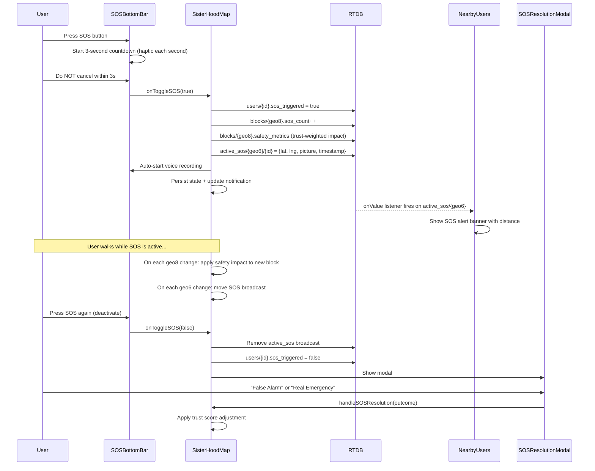

### SOS Activation Triggers (3 independent methods)

| Trigger | File | Mechanism |
|---|---|---|
| **UI Button** | SOSBottomBar.jsx | 3-second countdown with haptic feedback per second; cancel by tapping again |
| **Volume Buttons** | volumeTrigger.js | 3 presses within 2 seconds triggers SOS + haptic notification |
| **Voice Command** | SOSBottomBar.jsx | Continuous speech recognition listening for "help" or "sos" keywords |

---

## 9. Trust Score System

**File**: `trustScoreManager.js` (130 lines)

The trust score is a per-user reputation number (1.0 - 10.0) that determines how much weight their SOS signals carry on block safety scores. This prevents false alarms from destroying a block's safety rating.

### Trust Score Lifecycle

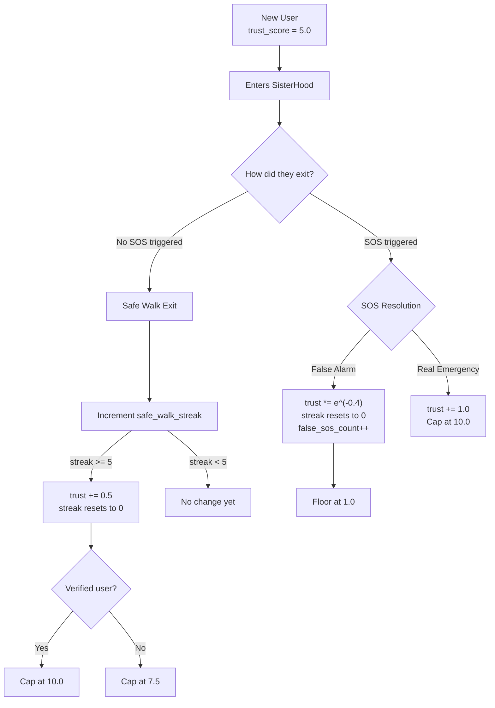

### Mathematical Formulas

**False Alarm Penalty** (exponential decay):
```
new_trust = max(1.0, trust_score * e^(-0.4))
```
Example: trust=5.0 -> 5.0 * 0.6703 = 3.35

**Real Emergency Boost** (linear):
```
new_trust = min(10.0, trust_score + 1.0)
```

**Safe Walk Streak Bonus** (threshold-gated):
```
if (streak >= 5):
    new_trust = min(cap, trust_score + 0.5)
    streak = 0
```
Cap = 7.5 for unverified users, 10.0 for verified.

### Server Sync

Trust score lives primarily in Zustand (client state) and RTDB (real-time sync). On exit, `useTrustScore.js` calls `api.patch('/api/user/sisterhood-exit')` to flush the final values to Firestore (persistent store).

---

## 10. Block Safety Score (Reverse Gaussian Model)

**File**: `trustScoreManager.js` — `computeBlockSafetyImpact()`

Every geohash8 block has a `current_score` (1.0 - 10.0) reflecting how safe it is. When an SOS is triggered in a block, the score drops. The key insight: **not all SOS events are equal** — a trusted user's SOS has more impact than a user who frequently triggers false alarms.

### The Formula

```
effectiveTrust    = trustScore * timeOfDayMultiplier
decayedImpact     = oldImpact * e^(-0.01 * hoursSinceLast)
newWeightedImpact = decayedImpact + effectiveTrust
current_score     = max(1.0, 10 * e^(-0.05 * newWeightedImpact))
```

### Time-of-Day Multiplier

| Time Range | Multiplier | Reasoning |
|---|---|---|
| 10pm - 4am | 1.5x | Late night SOS carries more danger weight |
| 8am - 6pm | 0.7x | Daytime SOS is less alarming |
| Other times | 1.0x | Shoulder hours — neutral |

### Time Decay (Self-Healing)

Old SOS events decay away over time:
```
decayedImpact = impact * e^(-0.01 * hours)
```
Half-life is approximately 70 hours. After 3 days of no SOS events, a block's safety score naturally recovers.

### Progressive Impact Examples

| SOS Events (trust=5) | Weighted Impact | Score |
|---|---|---|
| 1 | 5 | ~7.8 |
| 3 | 15 | ~4.7 |
| 6 | 30 | ~2.2 |
| 10 | 50 | ~1.1 |

### Where It Runs

The `computeBlockSafetyImpact()` function runs client-side inside RTDB `runTransaction` calls. This means:
- It's atomic — no race conditions between multiple users
- It reads the current block state, computes the new score, and writes it back in one operation
- The updated score is immediately visible to all users in that block via the `useSafetyScore` hook

---

## 11. Background Service Architecture

**File**: `backgroundService.js` (201 lines)

When the user minimizes the app, SisterHood keeps running via Expo's `TaskManager` and `Location.startLocationUpdatesAsync`.

### State Persistence via AsyncStorage

The background task runs in a separate JavaScript context — it cannot access React state or refs. Solution: persist critical state to `AsyncStorage` before going to background, and read it from the background task.

| Key | Purpose |
|---|---|
| `bg_userId` | Current user ID |
| `bg_sosActive` | Whether SOS is active |
| `bg_lastGeo6` | Last geohash6 (for SOS broadcast migration) |
| `bg_lastGeo8` | Last geohash8 (for block safety impact) |
| `bg_blocks` | Currently tracked blocks (JSON array) |
| `bg_isRecording` | Whether voice recording is in progress |

### Background Task Logic

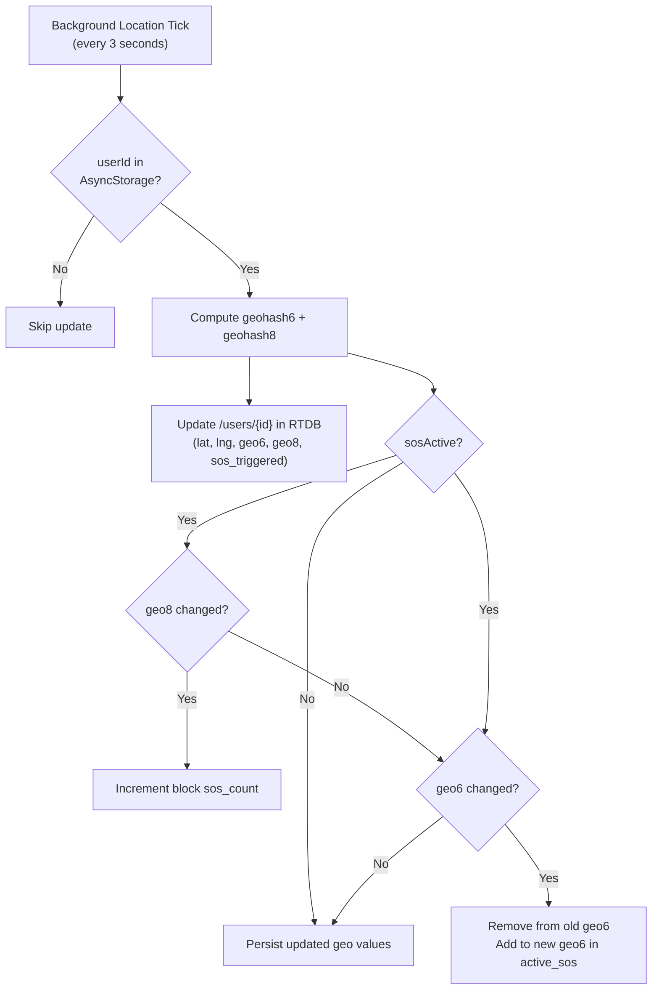

### Android Foreground Service

Android requires a persistent notification for background location. The configuration:
```javascript
{
  accuracy: Location.Accuracy.High,
  timeInterval: 3000,      // Update every 3 seconds
  distanceInterval: 1,      // Minimum 1 meter movement
  foregroundService: {
    notificationTitle: 'Sisterhood Shield Active',
    notificationBody: 'Your location is being tracked for safety.',
    notificationColor: '#dc2626',
  }
}
```

---

## 12. Notification Actions System

**File**: `notificationActions.js` (249 lines)

The persistent Android notification has 4 action buttons the user can tap without opening the app:

| Button | Action |
|---|---|
| Record | Start/stop voice recording in background |
| SOS | Toggle SOS on/off |
| Call 112 | Dial India's emergency number |
| Exit | Full cleanup: stop service, remove from RTDB, dismiss notification |

### Background Voice Recording

When the user taps "Record" from the notification:
1. Audio permissions are checked
2. `expo-av` recording starts in high quality mode
3. Notification body updates to "RECORDING VOICE NOTE..."
4. On second tap: recording stops, audio file is uploaded to `/api/voice/upload` with the user's last known GPS coordinates
5. The upload uses `multipart/form-data` with the audio file, user ID, and location

### SOS From Notification

Toggling SOS from the notification:
1. Reads current `sosActive` from AsyncStorage
2. Inverts it
3. Updates AsyncStorage + RTDB user node + active_sos broadcast
4. Emits `DeviceEventEmitter` event so the foreground UI syncs immediately if the app is active

---

## 13. Voice and Hardware Triggers

### Volume Button Trigger

**File**: `volumeTrigger.js` (73 lines)

Uses the `react-native-volume-manager` library to intercept hardware volume button presses:

```
Press volume 3 times within 2 seconds -> SOS activated
```

**Implementation**:
- `VolumeManager.addVolumeListener` fires on every volume change
- `clickCount` increments if the interval between presses is < 2 seconds
- At 3 clicks: trigger callback, reset counter, provide haptic feedback via `expo-haptics`
- Native volume UI is hidden (`showNativeVolumeUI: false`) to prevent the volume slider from appearing during SOS activation

### Voice Trigger (Speech Recognition)

**File**: `SOSBottomBar.jsx`

Uses `expo-speech-recognition` for continuous background listening:

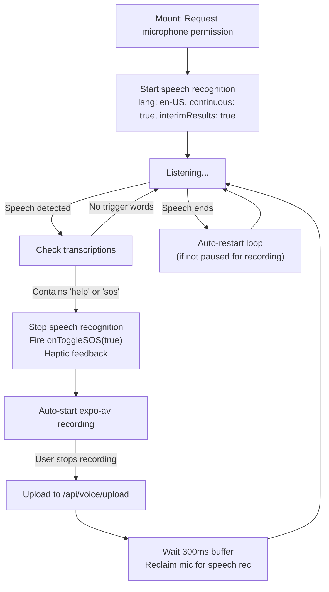

**Mutually Exclusive Microphone Access**: The microphone can only be used by one API at a time. When the user starts a voice recording (expo-av), the speech recognition loop must stop. When recording ends, a 300ms buffer ensures expo-av fully releases the hardware before speech recognition resumes. This is managed through `wasSisterHoodPausedForRecording` and `isSisterHoodActive` refs.

---

## 14. SOSBottomBar Component

**File**: `_components/SOSBottomBar.jsx` (513 lines)

A bottom action bar with three buttons:

```
[Record]    [  SOS  ]    [Call 112]
  Mic         Shield       Phone
```

### SOS Button States

| State | Visual | Behavior |
|---|---|---|
| Default | Red circle, "SOS" text | Tap starts 3-second countdown |
| Countdown | Yellow circle, number text | Tap cancels countdown |
| Active | Dark red, pulsing animation, "ACTIVE" text | Tap deactivates SOS |

### 3-Second Countdown Logic

```javascript
// 1. First tap: start countdown at 3
setCountdown(3);
// 2. Each second: decrement with haptic feedback
//    - Heavy haptic on first tap
//    - Medium haptic each countdown tick
// 3. After 3 seconds: activate SOS with Error haptic
// 4. Tap during countdown: cancel (Light haptic)
```

### Call 112 Button

Same countdown pattern, but instead of activating SOS alone, it:
1. Activates SOS (broadcasts location)
2. Dials 112 via `Linking.openURL('tel:112')`

If SOS is already active, Call 112 dials immediately without countdown.

---

## 15. SOSResolutionModal Component

**File**: `_components/SOSResolutionModal.jsx` (157 lines)

Shown when the user deactivates SOS. Presents two options:

| Option | Effect on Trust Score |
|---|---|
| "Yes, False Alarm" | `trust *= e^(-0.4)`, streak resets, false count++ |
| "No — Real Emergency" | `trust += 1.0`, cap at 10.0 |

The modal cannot be dismissed without choosing — this is intentional. Every SOS event must be classified to keep the trust scoring system accurate.

---

## 16. Compass and Map Rendering

### useCompass Hook

**File**: `_utils/useCompass.js` (71 lines)

Instead of using React state for compass heading (which would cause 10+ re-renders per second), this hook drives a **React Native Animated.Value** which is processed on the native thread:

- `Location.watchHeadingAsync` provides raw compass data
- Throttled to prevent jitter (default: 200ms, 2-degree threshold)
- **Shortest turn direction**: Prevents 358-to-2-degree jumps from animating 356 degrees clockwise — instead calculates the 4-degree counter-clockwise path
- `useNativeDriver: true` ensures the animation runs at 60fps without blocking the JS thread

### Map Configuration

The map uses a custom dark theme with 10+ style overrides for a premium night-mode appearance:
- Dark geometry (#242f3e)
- Gold-tinted labels (#d59563)
- Dark water (#17263c)
- Elevated road visualization

The camera is set to a 3D perspective:
```javascript
{
  zoom: 17,
  pitch: 50,  // Tilted downward for navigation view
}
```

### SOS Ghost Markers

Nearby users with active SOS appear as pulsing red dots on the map:
- Red outer ring (semi-transparent)
- Solid red core with white border
- "SOS" label badge below
- All sizes are scaled by `PixelRatio.get()` on Android to ensure consistent rendering across display densities

---

## 17. Graceful Exit System

**File**: `_utils/useGracefulExit.js` (102 lines)

When leaving SisterHood, all RTDB data must be cleaned up to prevent ghost users and stale block data.

### Exit Flow

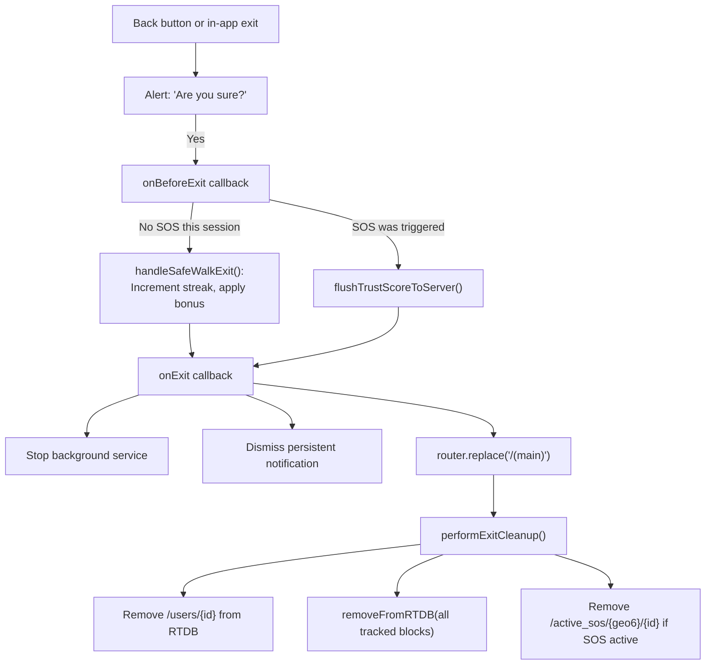

**Key decision**: Navigation happens FIRST (`router.replace`), then RTDB cleanup happens asynchronously. This ensures the user experiences zero lag when exiting — the cleanup runs in the background.

The `performExitCleanup` function is also exported as a standalone (non-hook) function so it can be called from notification actions in the background (where React hooks are not available).

---

## 18. Safety Agent (Python Backend)

**File**: `agents/brain/safety_agent.py` (71 lines)

This is a LangGraph single-node pipeline that audits chat reports for the admin dashboard. When a user reports another user for misconduct in StreetGig job chats, this agent analyzes the conversation.

### Pipeline

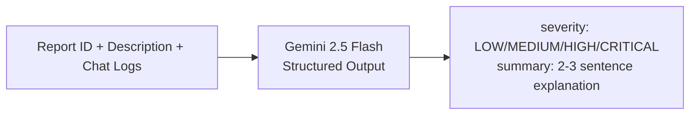

### Severity Tiers

| Tier | Definition |
|---|---|
| LOW | Minor disagreement, misunderstanding, mild spam |
| MEDIUM | Abusive language, unprofessional conduct, platform fee bypass attempts |
| HIGH | Harassment, threats, offensive language, scam attempts |
| CRITICAL | Physical safety threats, illegal activities, imminent harm |

---

## 19. Backend API Endpoints

| Endpoint | Method | Purpose |
|---|---|---|
| `/api/blocks/fetch` | POST | Fetch block safety data from Firestore for blocks not in RTDB |
| `/api/blocks/update` | POST | Flush block safety data back to Firestore when block goes empty in RTDB |
| `/api/user/sisterhood-exit` | PATCH | Persist trust score, false_sos_count, safe_walk_streak to Firestore |
| `/api/voice/upload` | POST | Upload audio recordings to Cloudinary with GPS coordinates |

---

## 20. Complete Data Flow Diagrams

### User Walk Session (No SOS)

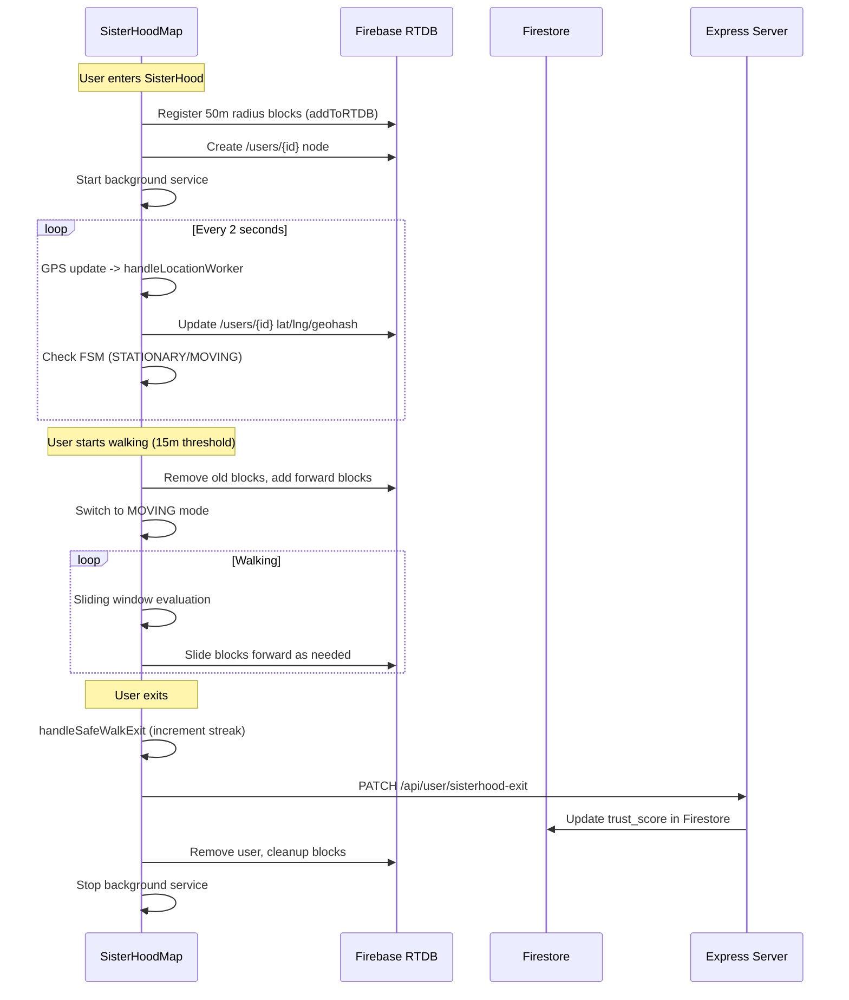

### SOS Event Flow

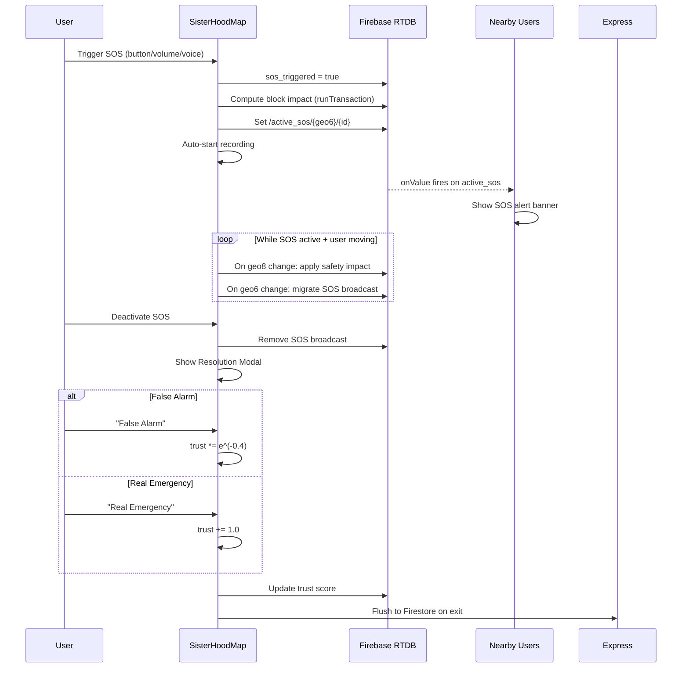
