# StreetGig — Complete Technical Deep-Dive

**Feature Summary**: StreetGig is an AI-powered hyperlocal gig-economy marketplace that connects employers with workers using Graph Retrieval-Augmented Generation (G-RAG) for skill matching, LangGraph agent pipelines for job enrichment and feedback processing, vector embeddings for semantic search, and real-time RTDB-powered job chat rooms.

---

## Table of Contents

1. [Architecture Overview](#1-architecture-overview)
2. [Folder Structure](#2-folder-structure)
3. [Main Screen: index.jsx](#3-main-screen-indexjsx)
4. [Job Creation Wizard: JobCreate.jsx](#4-job-creation-wizard-jobcreatejsx)
5. [My Jobs + AI Worker Matching: MyJobs.jsx](#5-my-jobs--ai-worker-matching-myjobsjsx)
6. [AI Rating System: RatingModal.jsx](#6-ai-rating-system-ratingmodaljsx)
7. [AI Career Growth: LearningSchemesModal.jsx](#7-ai-career-growth-learningschemesmodaljsx)
8. [Real-Time Chat: JobChat.jsx and ConversationsWrapper.jsx](#8-real-time-chat-jobchatjsx-and-conversationswrapperjsx)
9. [Supporting Components: JobList, JobCard, WorkerPrompt, WorkerProfileModal, ReportModal](#9-supporting-components)
10. [Backend AI Pipeline: Job Agent (LangGraph)](#10-backend-ai-pipeline-job-agent-langgraph)
11. [Skill Extraction: skill_graph_agent.py](#11-skill-extraction-skill_graph_agentpy)
12. [G-RAG Pipeline: Graph Retrieval-Augmented Generation](#12-g-rag-pipeline-graph-retrieval-augmented-generation)
13. [Graph Scorer: Composite Matching Formula](#13-graph-scorer-composite-matching-formula)
14. [Context Re-Ranker: LLM Final Ranking](#14-context-re-ranker-llm-final-ranking)
15. [Trajectory Agent: Exponentially Weighted Skill Scoring](#15-trajectory-agent-exponentially-weighted-skill-scoring)
16. [Graph Writebacks: Post-Job Edge Updates](#16-graph-writebacks-post-job-edge-updates)
17. [Skill Gap Agent: Feedback-to-Vector Pipeline](#17-skill-gap-agent-feedback-to-vector-pipeline)
18. [Safety Agent: Trust and Safety Auditor](#18-safety-agent-trust-and-safety-auditor)
19. [MongoDB Graph Data Model](#19-mongodb-graph-data-model)
20. [Complete End-to-End Flows](#20-complete-end-to-end-flows)

---

## 1. Architecture Overview

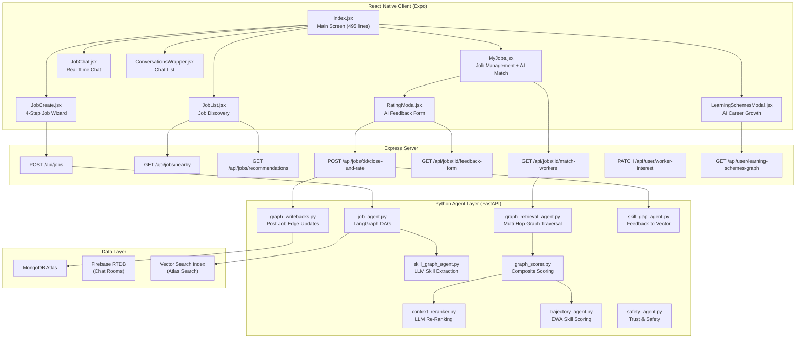

---

## 2. Folder Structure

```
StreetGig/                          -- Client screens
  index.jsx                         -- Main screen with tabs, navigation, data fetching (495 lines)
  JobCreate.jsx                     -- 4-step job creation wizard (295 lines)
  JobList.jsx                       -- Job list with AI match badges (2520 bytes)
  JobCard.jsx                       -- Individual job card component (3998 bytes)
  MyJobs.jsx                        -- My jobs + "Find Workers" with AI matching (200 lines)
  RatingModal.jsx                   -- AI-generated feedback form (241 lines)
  LearningSchemesModal.jsx          -- AI career growth recommendations (254 lines)
  JobChat.jsx                       -- Real-time RTDB chat (15552 bytes)
  ConversationsWrapper.jsx          -- Chat room list with real-time updates (15678 bytes)
  WorkerPrompt.jsx                  -- Worker profile registration modal (7304 bytes)
  WorkerProfileModal.jsx            -- View worker profile details (4481 bytes)
  ReportModal.jsx                   -- Report worker for misconduct (3940 bytes)

agents/brain/streetgig/             -- Python AI agents
  job_agent.py                      -- LangGraph DAG: job enrichment pipeline (178 lines)
  skill_graph_agent.py              -- LLM skill extraction + graph upsert (77 lines)
  graph_retrieval_agent.py          -- Multi-hop graph traversal for worker matching (99 lines)
  graph_scorer.py                   -- Composite scoring formula (72 lines)
  context_reranker.py               -- LLM re-ranking with explanations (68 lines)
  trajectory_agent.py               -- Exponentially weighted skill trajectory (66 lines)
  graph_writebacks.py               -- Post-job graph edge updates (126 lines)
  skill_gap_agent.py                -- Feedback->skill gap string->vector (96 lines)

agents/brain/safety_agent.py        -- Trust & Safety auditor (71 lines)
agents/brain/vyomai/tools/streetgig.py  -- VYOM AI StreetGig tools
```

---

## 3. Main Screen: index.jsx

**File**: `StreetGig/index.jsx` (495 lines)

This is the container component that orchestrates the entire StreetGig experience. It manages:
- **User profile state** (worker mode on/off, categories)
- **Job data fetching** (nearby jobs vs. AI recommendations)
- **Tab navigation** (ALL / MY / CREATE tabs + list/chat mobile tabs)
- **Chat room creation** via Firebase RTDB
- **Worker toggle** and profile management

### State Overview

| State | Type | Purpose |
|---|---|---|
| `activeTab` | `'ALL' \| 'MY' \| 'CREATE'` | Current content tab |
| `mobileTab` | `'list' \| 'chat'` | Bottom navigation tab |
| `userProfile` | `object` | Worker categories, interestedToWork, hasSeenWorkerPrompt |
| `jobs` | `Array` | All/recommended jobs |
| `myJobs` | `Array` | Jobs posted by the current user |
| `selectedJob` | `object` | Currently selected job for chat |
| `userLocation` | `{lat, lng}` | GPS coordinates for nearby search |
| `timeFilter` | `string` | Time slot filter for recommendations |
| `minPriceFilter` | `string` | Minimum budget filter |

### Key Logic: Worker Mode

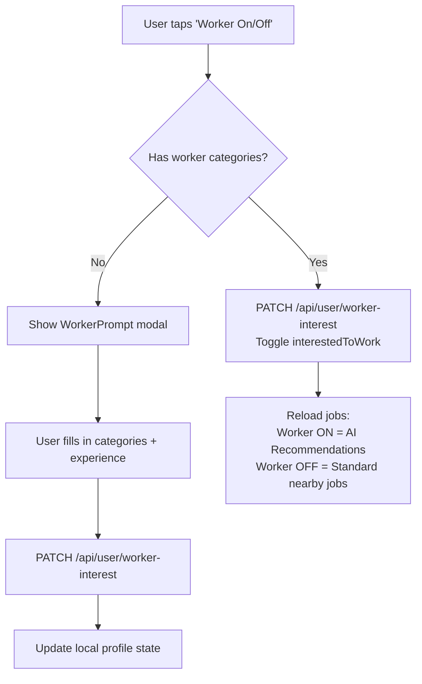

**Key distinction**: When `interestedToWork` is `true`, the job list calls `/api/jobs/recommendations` which runs the full G-RAG pipeline. When `false`, it calls `/api/jobs/nearby` which returns all open jobs sorted by distance.

### Data Fetching Strategy

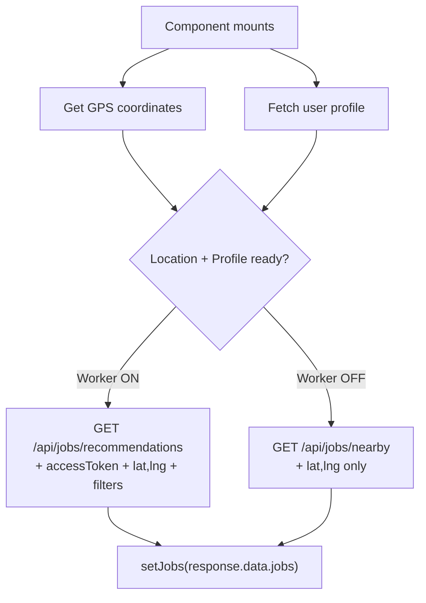

### Chat Room Architecture

When a user selects a worker from the AI matching results, the client creates a Firebase RTDB chat room:

```javascript
// Room ID formula: deterministic, prevents duplicates
const participants = [employerId, workerId].sort();
const chatRoomSuffix = `${participants[0]}_${participants[1]}`;
const chatRoomId = `${jobId}_chat_${chatRoomSuffix}`;
```

**Why sort participants?** Without sorting, employer A chatting with worker B would create a different room ID than worker B chatting with employer A. Sorting ensures both parties always generate the same room ID.

The chat room stores:
- `members`: Both parties with join timestamps and user info
- `jobMeta`: Deal terms (amount, time, category, title 

### Category System

StreetGig supports 30 job categories. These are defined as sorted arrays on the client:

```
AC Repair, Appliance Repair, Beauty & Salon, BMS Operator, Carpenter,
Civil Work, Cleaners, Deep Cleaning, Delivery, Electrician, Flooring,
Gardening, Home Renovation, House Sitting, Interior Design, Janitorial Services,
Maintenance, Masonry, Mechanic, Movers, Painters, Pest Control,
Photography, Plumber, Roofing, Scaffolding, Security, Tailor,
Tech Support, Welding
```

### Time Slot System

6 predefined time slots for job scheduling:

```
Quick (< 1 hr), 1-2 Hours, Half Day (4 hrs),
Full Day (8 hrs), Next 24 Hours, Flexible
```

---

## 4. Job Creation Wizard: JobCreate.jsx

**File**: `StreetGig/JobCreate.jsx` (295 lines)

A 4-step wizard with progress bar for posting new jobs.

### Steps

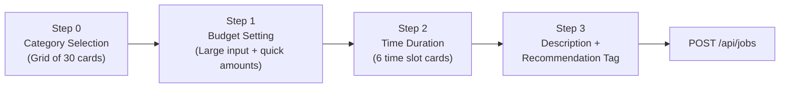

| Step | Validation | UI Pattern |
|---|---|---|
| 0: Category | Must select one category | Grid of cards with sparkle icons |
| 1: Budget | Must enter amount | Large centered rupee input + quick buttons (200, 500, 1000, 2000) |
| 2: Time | Must select one slot | List of slot cards with clock icons |
| 3: Description | Must enter description | Large text area + optional recommendation chips |

### Recommendation Tags

Optional tags that influence AI matching:
- **Urgent Fix**: Prioritize speed
- **Quality First**: Prioritize skill ratings
- **Budget Friendly**: Prioritize affordability
- **Professional Required**: Prioritize experience
- **Material Provided**: No material procurement needed

### What Happens on Submit

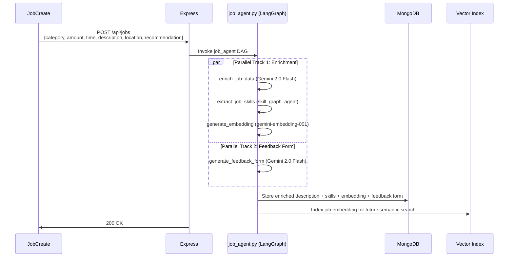

---

## 5. My Jobs + AI Worker Matching: MyJobs.jsx

**File**: `StreetGig/MyJobs.jsx` (200 lines)

Shows jobs posted by the current user. Each open job has a "Find Workers" button that triggers the G-RAG pipeline.

### AI Worker Matching Flow

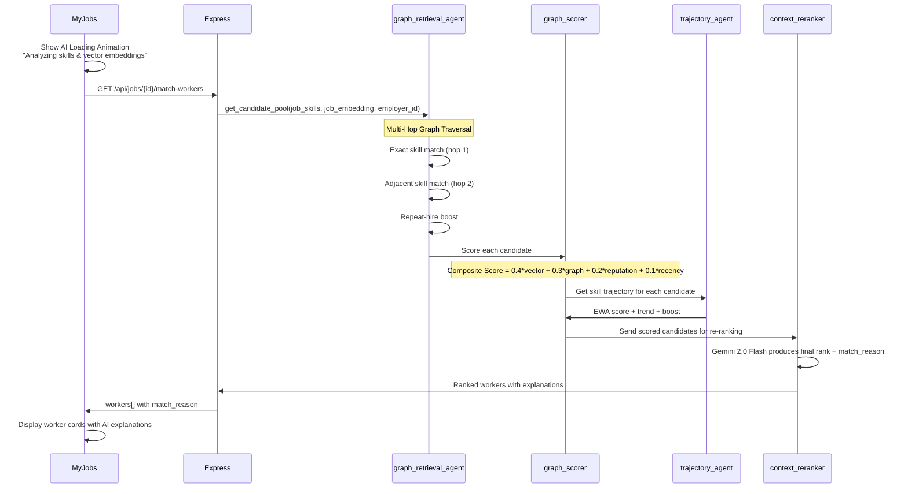

### UI Details

Each worker card shows:
- Profile picture + name
- Star rating + completed jobs count
- **AI match reason**: A natural-language explanation like "Strong plumbing skills with improving trajectory. Repeat hire with 3 previous completions for you."
- Chat button to start a conversation

The "AI Loading Animation" uses `react-native-reanimated` with a pulsing sparkle icon and text "AI is finding the best workers... Analyzing skills & vector embeddings". A minimum 2-second delay is enforced to showcase the AI processing UX:

```javascript
const [res] = await Promise.all([
  api.get(`/api/jobs/${job.id}/match-workers`, ...),
  new Promise(resolve => setTimeout(resolve, 2000))
]);
```

---

## 6. AI Rating System: RatingModal.jsx

**File**: `StreetGig/RatingModal.jsx` (241 lines)

When a job completes, the employer rates the worker using an AI-generated feedback form.

### Flow

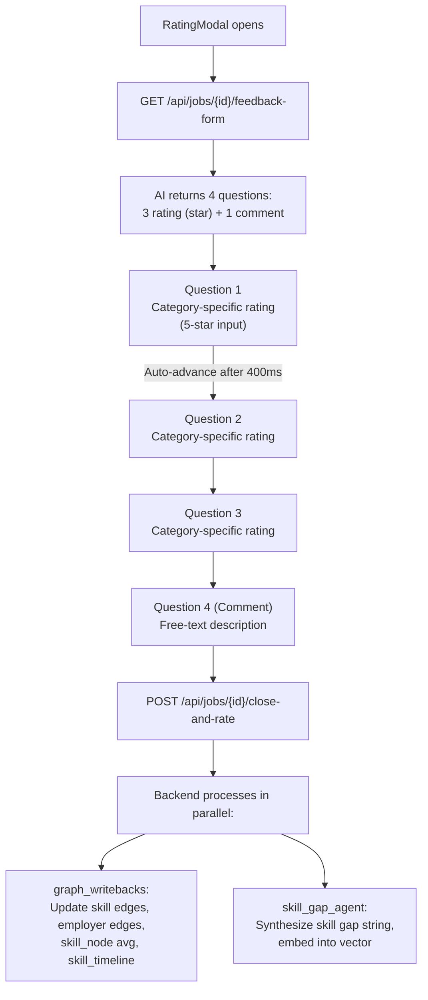

### AI-Generated Questions

Instead of generic "Rate 1-5" questions, the AI generates category-specific questions. For example, a plumbing job might get:

1. "How would you rate the plumber's punctuality?" (rating)
2. "How was the water pressure after the repair?" (rating)
3. "Did the plumber clean up after completing work?" (rating)
4. "Any additional comments or suggestions?" (comment)

The frontend sends `pairedQuestions` — an array of `{question, type, answer}` objects — to the backend. This pairing is crucial because the skill_gap_agent needs both the question context AND the answer to synthesize meaningful skill gap vectors.

### Fallback Questions

If the AI fails to generate questions:
```javascript
[
  { question: "How was the worker's punctuality?", type: "rating", max_score: 5 },
  { question: "How was the worker's quality of work?", type: "rating", max_score: 5 },
  { question: "How was the worker's professionalism?", type: "rating", max_score: 5 },
  { question: "Do you have any additional comments?", type: "comment" }
]
```

---

## 7. AI Career Growth: LearningSchemesModal.jsx

**File**: `StreetGig/LearningSchemesModal.jsx` (254 lines)

Shows government skill development schemes recommended by AI based on the worker's profile and feedback history.

### Two Tab System

| Tab | Source | Logic |
|---|---|---|
| **Upgradation** | Worker's current skill categories | Matches master profile skills against government scheme database using vector similarity |
| **Improvement** | AI feedback from completed jobs | Uses skill_gap_embeddings from the skill_gap_agent to find schemes that address the worker's weak areas |

### API: GET /api/user/learning-schemes-graph

The backend:
1. Reads the worker's `workerCategories` (e.g., ["Plumber", "Electrician"])
2. Reads the worker's `skill_gap_embeddings` from their most recent feedback cycles
3. Runs vector similarity search against a `government_schemes` collection
4. Returns two sorted lists: `upgradationCourses` and `improvementCourses`

### Scheme Card Display

Each scheme card shows:
- Title and provider (e.g., "PMKVY Advanced Plumbing — NSDC")
- **Similarity score** as a percentage badge (e.g., "87% Match")
- Duration and eligibility tags
- Description text
- Benefits/stipend information

---

## 8. Real-Time Chat: JobChat.jsx and ConversationsWrapper.jsx

### JobChat.jsx (15,552 bytes)

A full messaging interface built on Firebase RTDB:

- Messages stored at `/jobs/rooms/{chatRoomId}/messages/{messageId}`
- Real-time listener via `onValue`
- Supports text messages and system messages
- Job metadata header showing deal terms (amount, time, category)
- Worker profile access and report functionality

### ConversationsWrapper.jsx (15,678 bytes)

Lists all active chat rooms for the current user:

- Scans `/jobs/rooms/` for rooms containing the user's ID
- Shows last message preview, other party's name, and job title
- Real-time updates when new messages arrive
- "Browse Jobs" CTA when no conversations exist

### RTDB Chat Schema

```json
{
  "jobs": {
    "rooms": {
      "{jobId}_chat_{sortedParticipants}": {
        "members": {
          "{userId}": {
            "joinedAt": "<server_timestamp>",
            "userName": "Shreyansh",
            "userImage": "https://..."
          }
        },
        "jobMeta": {
          "amount": 500,
          "time": "1-2 Hours",
          "category": "Plumber",
          "title": "Plumber"
        },
        "messages": {
          "{pushId}": {
            "text": "Hi, I can fix your pipe leak.",
            "senderId": "auth0|abc123",
            "senderName": "Worker Name",
            "timestamp": "<server_timestamp>"
          }
        }
      }
    }
  }
}
```

---

## 9. Supporting Components

### WorkerPrompt.jsx (7,304 bytes)

Modal shown when a user first tries to enable worker mode. Collects:
- Worker categories (multi-select from 30 categories)
- Experience level
- Free-text description of skills

### WorkerProfileModal.jsx (4,481 bytes)

Read-only modal showing a worker's profile:
- Profile picture, name
- Categories, experience
- Rating, completed jobs count
- Description

### ReportModal.jsx (3,940 bytes)

Modal for reporting misconduct. Collects a text description of the issue, sends it along with chat logs to the `safety_agent.py` for AI severity classification.

### JobList.jsx (2,520 bytes) and JobCard.jsx (3,998 bytes)

The job discovery list. When AI matching is active (`isAiMatching=true`), job cards display an "AI Match" badge with the match score.

---

## 10. Backend AI Pipeline: Job Agent (LangGraph)

**File**: `agents/brain/streetgig/job_agent.py` (178 lines)

This is a compiled LangGraph DAG (Directed Acyclic Graph) that processes every new job posting.

### Graph Structure

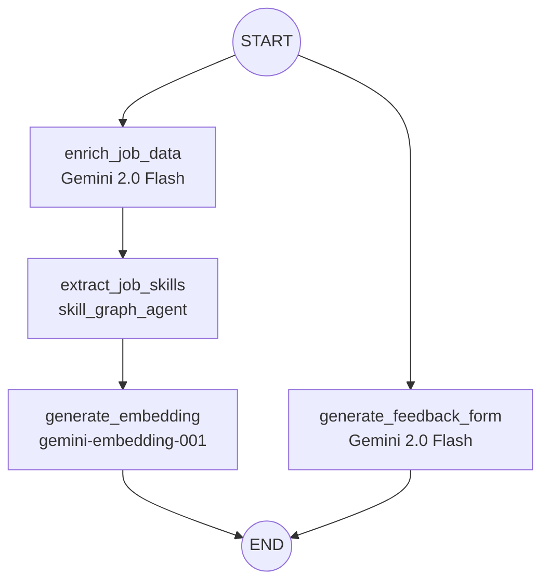

### Node Details

| Node | Input | Output | LLM |
|---|---|---|---|
| `enrich_job_data` | category, description, amount, time, location | enriched_description | Gemini 2.0 Flash (temperature=0.2) |
| `extract_job_skills` | enriched_description | SkillExtractionResult (skills[], experience_level, category_guess) | Gemini 2.0 Flash |
| `generate_embedding` | enriched_description | 768-dimension float vector | gemini-embedding-001 |
| `generate_feedback_form` | category, amount, time | 4 FeedbackQuestions (3 rating + 1 comment) | Gemini 2.0 Flash |

### Parallelism

The graph runs two independent tracks simultaneously:
- **Track 1**: enrich -> extract skills -> generate embedding (sequential — each step depends on the previous)
- **Track 2**: generate feedback form (independent — only needs the job metadata)

Both tracks join at END. This halves the total latency compared to running everything sequentially.

### State Schema (Pydantic)

```python
class JobAgentState(BaseModel):
    # Inputs
    job_id: str
    description: Optional[str] = ""
    category: str
    location: str
    amount: float
    time: str

    # Outputs
    enriched_description: Optional[str] = None
    feedback_form: Optional[List[FeedbackQuestion]] = None
    extracted_skills: Optional[SkillExtractionResult] = None
    job_embedding: Optional[List[float]] = None
```

---

## 11. Skill Extraction: skill_graph_agent.py

**File**: `agents/brain/streetgig/skill_graph_agent.py` (77 lines)

### Purpose

Takes free-form text (a job description or worker profile) and extracts discrete, queryable skill entities.

### How It Works

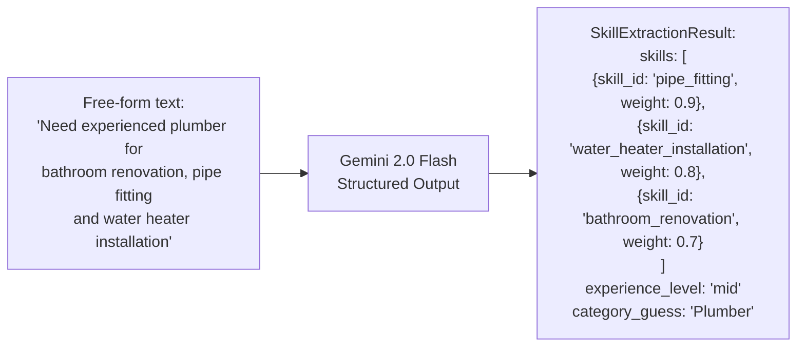

### Output Schema

```python
class SkillEntity(BaseModel):
    skill_id: str     # Normalized lowercase, snake_case identifier
    weight: float     # 0.0-1.0 — how important this skill is in context

class SkillExtractionResult(BaseModel):
    skills: List[SkillEntity]
    experience_level: str    # 'junior' | 'mid' | 'senior'
    category_guess: str      # Best-fit from the 30 categories
```

### Graph Upsert

After extraction, `upsert_skill_nodes()` writes each skill to the `skill_nodes` MongoDB collection:

```python
skill_nodes.update_one(
    {'skill_id': skill.skill_id},
    {'$setOnInsert': {
        'skill_id': skill.skill_id,
        'created_at': now,
        'avg_rating': 0.0,
        'job_count': 0
    }, '$set': {'updated_at': now}},
    upsert=True
)
```

This ensures every skill mentioned across the platform exists as a queryable node in the graph.

---

## 12. G-RAG Pipeline: Graph Retrieval-Augmented Generation

**File**: `agents/brain/streetgig/graph_retrieval_agent.py` (99 lines)

G-RAG is the core innovation in StreetGig's worker matching. Unlike traditional keyword search or even pure vector search, G-RAG traverses a **skill graph** to find workers through multi-hop relationships.

### What is the Skill Graph?

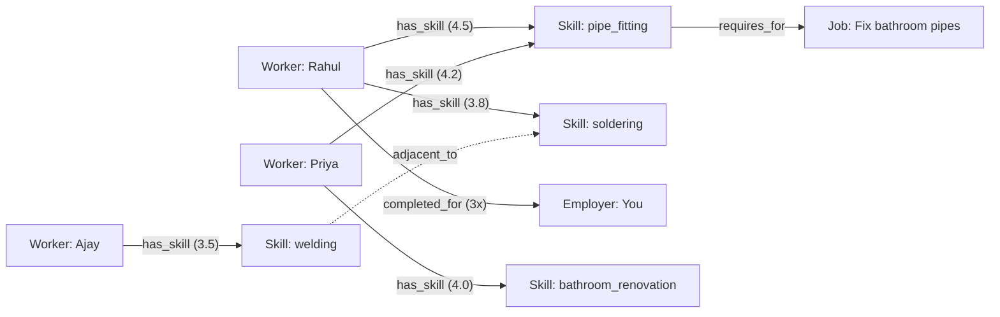

### Three-Hop Retrieval

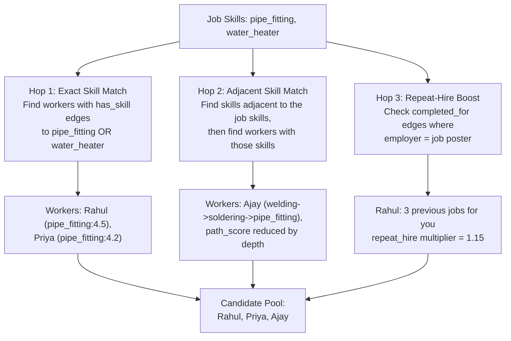

### Implementation Detail

```python
async def get_candidate_pool(job_skills, job_embedding, employer_id, db):
    candidates = {}

    # HOP 1: Exact skill match
    for skill in job_skills:
        edges = await db.graph_edges.find({
            'to_id': skill.skill_id,
            'relationship': 'has_skill'
        }).to_list(50)

        for edge in edges:
            worker_id = edge['from_id']
            if worker_id not in candidates:
                candidates[worker_id] = {'exact_skills': [], 'adjacent_skills': [], 'repeat_count': 0}
            candidates[worker_id]['exact_skills'].append({
                'skill_id': edge['to_id'],
                'weight': edge.get('weight', 3.0)
            })

    # HOP 2: Adjacent skill match (skills connected to the job skills)
    for skill in job_skills:
        adjacent_edges = await db.graph_edges.find({
            'from_id': skill.skill_id,
            'relationship': 'adjacent_to'
        }).to_list(20)

        for adj_edge in adjacent_edges:
            worker_edges = await db.graph_edges.find({
                'to_id': adj_edge['to_id'],
                'relationship': 'has_skill'
            }).to_list(20)

            for w_edge in worker_edges:
                worker_id = w_edge['from_id']
                if worker_id not in candidates:
                    candidates[worker_id] = {'exact_skills': [], 'adjacent_skills': [], 'repeat_count': 0}
                candidates[worker_id]['adjacent_skills'].append({
                    'skill_id': w_edge['to_id'],
                    'via': skill.skill_id,
                    'weight': w_edge.get('weight', 2.0) * 0.7  # Reduced weight for indirect match
                })

    # HOP 3: Repeat-hire boost
    repeat_edges = await db.graph_edges.find({
        'to_id': employer_id,
        'relationship': 'completed_for'
    }).to_list(50)

    for edge in repeat_edges:
        worker_id = edge['from_id']
        if worker_id in candidates:
            candidates[worker_id]['repeat_count'] = edge.get('metadata', {}).get('repeat_count', 1)

    return candidates
```

---

## 13. Graph Scorer: Composite Matching Formula

**File**: `agents/brain/streetgig/graph_scorer.py` (72 lines)

Each candidate gets a composite score from 4 weighted signals:

### The Formula

```
FINAL_SCORE = (0.40 * vector_similarity)
            + (0.30 * graph_path_score)
            + (0.20 * reputation_score)
            + (0.10 * recency_score)
            * safety_multiplier
```

### Signal Breakdown

| Signal | Weight | How It's Computed |
|---|---|---|
| **Vector Similarity** | 40% | Cosine similarity between job embedding and worker profile embedding (768-dim, gemini-embedding-001) |
| **Graph Path Score** | 30% | Averaged edge weights from the graph traversal. Exact matches use full weight; adjacent matches use 70% weight. Normalized to 0-1. |
| **Reputation** | 20% | Weighted average of: overall rating (60%), completed jobs count (30%), active streak (10%). Normalized to 0-1. |
| **Recency** | 10% | Based on `days_since_last_job`. Yesterday = 1.0, last week = 0.7, last month = 0.3, older = 0.1. |

### Safety Multiplier

```python
if has_trust_flag with severity >= HIGH:
    safety_multiplier = 0.0  # Worker is completely excluded
elif has_trust_flag with severity == MEDIUM:
    safety_multiplier = 0.5  # Score halved
else:
    safety_multiplier = 1.0  # No penalty
```

### Repeat-Hire Bonus

```python
if repeat_count >= 1:
    score *= 1.15  # 15% boost for returning workers
```

### Cold-Start Handling

New workers with no history get default scores:
```python
vector_similarity = 0.5   # Neutral
graph_path_score = 0.0     # No graph data yet
reputation = 0.3           # Below average but not zero
recency = 0.5              # Neutral
```

This means new workers still appear in results but rank below established workers with actual track records.

---

## 14. Context Re-Ranker: LLM Final Ranking

**File**: `agents/brain/streetgig/context_reranker.py` (68 lines)

After composite scoring, the top candidates are sent to Gemini 2.0 Flash for final re-ranking with human-readable explanations.

### Prompt Structure

```
You are a matchmaking AI. Re-rank these pre-scored candidates for this job:

Job: {enriched_description}
Required Skills: {skills}

Candidate 1: {name}
  - Score: 0.87
  - Exact Skills: pipe_fitting (4.5), water_heater (3.8)
  - Adjacent Skills: soldering (via welding, 2.8)
  - Reputation: 4.2/5 (12 jobs)
  - Repeat Hire: 3 times with this employer

[...more candidates...]

For each candidate, provide:
1. A natural-language explanation of why they match
2. Final rank position
3. Any concerns or caveats
```

### Output

Each worker gets a `match_reason` string displayed in the UI:

> "Rahul has strong pipe fitting skills (4.5/5) with 12 completed jobs.
> He has worked for you 3 times before with consistently high ratings.
> His soldering skills are transferable to this type of work."

This is the key differentiator of G-RAG over traditional matching: **transparent, explainable AI** where the user understands WHY each worker was recommended.

---

## 15. Trajectory Agent: Exponentially Weighted Skill Scoring

**File**: `agents/brain/streetgig/trajectory_agent.py` (66 lines)

### Problem

A worker rated 5 stars three years ago and 2 stars recently has a simple average of 3.5. But their *trajectory* is declining — they're getting worse. Traditional averaging hides this.

### Solution: Exponentially Weighted Average (EWA)

```
EWA = alpha * current_rating + (1 - alpha) * previous_EWA
alpha = 0.3
```

With alpha=0.3:
- Most recent rating contributes 30% of the EWA
- Second most recent: 21% (0.3 * 0.7)
- Third: 14.7% (0.3 * 0.7^2)
- ...and so on, exponentially decaying

### Trend Detection

```python
if len(ratings) >= 4:
    mid = len(ratings) // 2
    first_half_avg = average(ratings[:mid])
    second_half_avg = average(ratings[mid:])

    if second_half_avg - first_half_avg > 0.5:
        trend = 'improving'
    elif first_half_avg - second_half_avg > 0.5:
        trend = 'declining'
    else:
        trend = 'stable'
```

### Trajectory Boost

Workers on an improving trajectory get a score bonus:

```python
if trend == 'improving' and EWA > raw_average:
    delta = min((EWA - raw_average) / 5.0, 0.08)  # Max 8% boost
    final_score = min(base_score + delta, 1.0)
```

This rewards workers who are actively improving their skills, even if their historical average is lower than a stagnant worker.

---

## 16. Graph Writebacks: Post-Job Edge Updates

**File**: `agents/brain/streetgig/graph_writebacks.py` (126 lines)

When a job is closed and rated, the system writes four types of graph edges:

### Edge Types

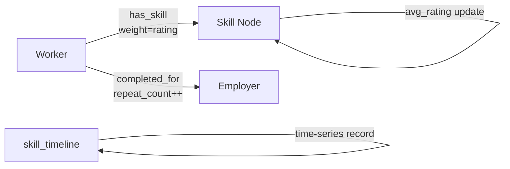

### 1. Worker -> Skill Edges

```python
for skill_id in skill_ids:
    db.graph_edges.update_one(
        {'from_id': worker_id, 'to_id': skill_id, 'relationship': 'has_skill'},
        {'$set': {'weight': rating, 'updated_at': now}},
        upsert=True
    )
```

The `weight` is the most recent rating. This means a worker's skill edge always reflects their latest performance.

### 2. Worker -> Employer Edge

```python
db.graph_edges.update_one(
    {'from_id': worker_id, 'to_id': employer_id, 'relationship': 'completed_for'},
    {'$set': {'weight': rating}, '$inc': {'metadata.repeat_count': 1}},
    upsert=True
)
```

The `repeat_count` increment is crucial for the repeat-hire bonus in graph_scorer.

### 3. Skill Node Rolling Average

```python
node = db.skill_nodes.find_one({'skill_id': skill_id})
new_avg = (old_avg * old_count + rating) / (old_count + 1)
db.skill_nodes.update_one(
    {'skill_id': skill_id},
    {'$set': {'avg_rating': new_avg}, '$inc': {'job_count': 1}}
)
```

### 4. Skill Timeline

```python
records = [{
    'worker_id': worker_id,
    'skill_id': s,
    'rating': rating,
    'job_id': job_id,
    'timestamp': now
} for s in skill_ids]
db.skill_timeline.insert_many(records)
```

This powers the trajectory agent's EWA calculations.

### Additional Writeback Functions

**write_safety_flag()**: Called by the safety agent when severity >= HIGH. Creates a `trust_flag` edge that the graph_scorer uses as a safety multiplier.

**write_scheme_completion()**: When a worker completes a government skill scheme:
- Creates a `completed_scheme` edge
- If `certified=True`: Creates `has_skill` edges for each taught skill with weight=4.0 and `certified: true` metadata
- Certified skills receive a 1.15x boost in the graph scorer

---

## 17. Skill Gap Agent: Feedback-to-Vector Pipeline

**File**: `agents/brain/streetgig/skill_gap_agent.py` (96 lines)

This LangGraph pipeline converts employer feedback into a searchable vector for matching workers with improvement courses.

### Pipeline

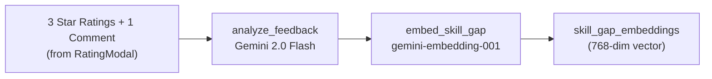

### Prompt

```
Analyze the following feedback an employer gave to a worker:

1. "How was the punctuality?" - 3 Stars
2. "How was pipe fitting quality?" - 2 Stars
3. "Did they clean up?" - 4 Stars

Employer's Comment: "Good at basic repairs but struggled with
the water heater installation. Could use training on that."

Synthesize a 'skill_gap_string' representing the worker's
verified strengths, highlighted areas for improvement,
and any newly acquired skills.
```

### Output Example

```
"The worker demonstrates competence in basic pipe repair and
cleanup procedures. However, there is a significant skill gap in
water heater installation and advanced plumbing tasks. Punctuality
and time management show room for improvement. Recommended focus
areas: water heater installation, advanced pipe routing,
time management skills."
```

This string is then embedded into a 768-dimension vector and stored alongside the worker's profile. The `LearningSchemesModal` uses this vector to find government courses that address the specific skill gaps identified by AI analysis of employer feedback.

---

## 18. Safety Agent: Trust and Safety Auditor

**File**: `agents/brain/safety_agent.py` (71 lines)

A LangGraph single-node pipeline for auditing reported conversations.

### Trigger

When a user files a report via `ReportModal.jsx`, the chat logs and description are sent to the safety agent.

### Analysis

```python
prompt = """
You are a Trust & Safety AI auditor for StreetGig.
Analyze chat conversations and user reports.

REPORTING USER'S REASON: {description}
CHAT LOGS: {chat_logs}

Assign a severity tier:
- LOW: Minor disagreement, misunderstanding, mild spam
- MEDIUM: Abusive language, unprofessional conduct, fee bypass attempts
- HIGH: Harassment, threats, offensive language, scam attempts
- CRITICAL: Physical safety threats, illegal activities, imminent harm
"""
```

### Consequence

When severity >= HIGH, `graph_writebacks.write_safety_flag()` is called, creating a `trust_flag` edge. This permanently impacts the worker's match scoring via the `safety_multiplier`:

- HIGH/CRITICAL: `safety_multiplier = 0.0` (worker is excluded from all future recommendations)
- MEDIUM: `safety_multiplier = 0.5` (score halved)

---

## 19. MongoDB Graph Data Model

### Collections

| Collection | Purpose | Key Fields |
|---|---|---|
| `graph_edges` | All relationships in the skill graph | from_id, to_id, relationship, from_type, to_type, weight, metadata |
| `skill_nodes` | Skill entity catalog | skill_id, avg_rating, job_count |
| `skill_timeline` | Time-series skill ratings | worker_id, skill_id, rating, job_id, timestamp |
| `jobs` | Job postings with embeddings | id, description, enriched_description, job_embedding, feedback_form, skills |
| `users` | User profiles with worker data | sub, workerCategories, interestedToWork, skill_gap_embeddings |

### Edge Types

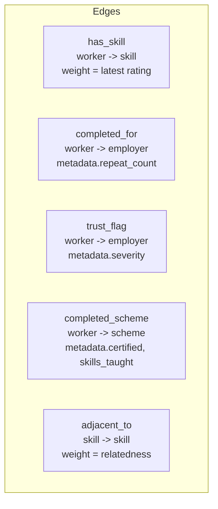

### Vector Search Index

The `jobs` collection has an Atlas Search vector index on the `job_embedding` field (768 dimensions). Worker profiles also have embedded vectors for semantic matching.

---

## 20. Complete End-to-End Flows

### Flow 1: Job Posting -> Worker Discovery -> Job Completion

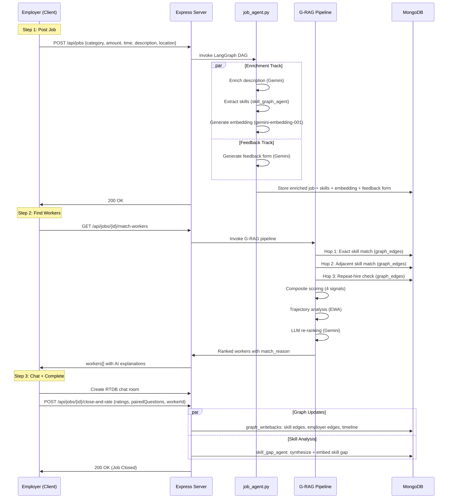

### Flow 2: Worker Skill Growth Cycle

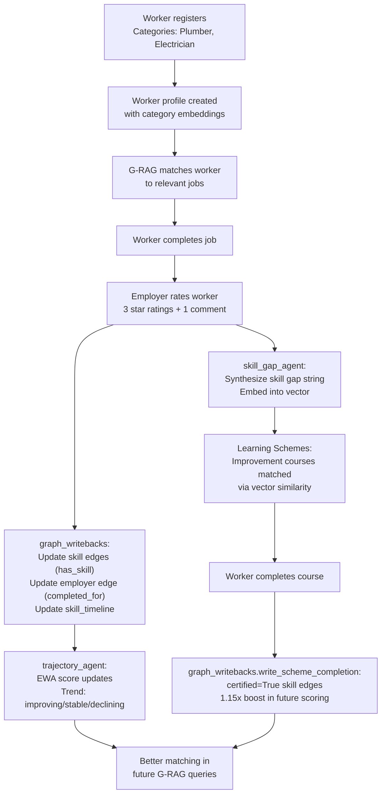

This creates a **virtuous cycle**: every job completion improves the worker's graph data, which leads to better matching, which leads to more jobs, which generates more feedback for skill gap analysis, which recommends targeted training, which further improves their scores.
