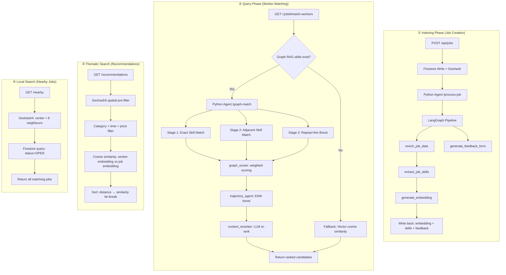

# StreetGigs — Technical Walkthrough

> Covers the **Indexing Phase**, **Query Phase**, **Thematic Search**, and **Local Search** pipelines end-to-end.

---

## High-Level Architecture



---

## ① Indexing Phase — What happens when a job is posted

**Trigger:** `POST /api/jobs` in [job.route.js](file:///Users/shreyanshsachan/Documents/sankalp/UrbanFlow/server/src/routes/job.route.js#L8-L111)

### Step 1 — Persist & respond immediately

| Action | Detail |
|---|---|
| Generate Firestore doc ID | `db.collection("jobs").doc()` |
| Compute geohashes | `ngeohash.encode(lat, lng, 4)` for local search, precision-6 for thematic |
| Write job + chat room | Parallel `Promise.all` — status `OPEN` |
| Respond to client | `"AI is enriching the description in the background."` |

### Step 2 — Fire-and-forget LangGraph pipeline

The server calls `POST /process-job` on the Python agent, which runs a **LangGraph `StateGraph`** defined in [job_agent.py](file:///Users/shreyanshsachan/Documents/sankalp/UrbanFlow/agents/brain/streetgig/job_agent.py).

The graph has **two parallel tracks** that converge at `END`:

```
START ──┬──► enrich_job_data ──► extract_job_skills ──► generate_embedding ──► END
        └──► generate_feedback_form ─────────────────────────────────────────► END
```

| Node | Model | Purpose |
|---|---|---|
| [enrich_job_data](file:///Users/shreyanshsachan/Documents/sankalp/UrbanFlow/agents/brain/streetgig/job_agent.py#L66-L93) | `gemini-2.0-flash` (structured) | Polishes/enriches the raw description |
| [extract_job_skills](file:///Users/shreyanshsachan/Documents/sankalp/UrbanFlow/agents/brain/streetgig/job_agent.py#L95-L108) | `gemini-2.0-flash` (structured via [skill_graph_agent](file:///Users/shreyanshsachan/Documents/sankalp/UrbanFlow/agents/brain/streetgig/skill_graph_agent.py)) | Extracts 3–8 atomic [SkillEntity](file:///Users/shreyanshsachan/Documents/sankalp/UrbanFlow/agents/brain/streetgig/skill_graph_agent.py#16-21) objects with `skill_id`, confidence, `is_primary` |
| [generate_embedding](file:///Users/shreyanshsachan/Documents/sankalp/UrbanFlow/agents/brain/streetgig/job_agent.py#L110-L125) | `gemini-embedding-001` (768-dim) | Creates a dense vector from the enriched description |
| [generate_feedback_form](file:///Users/shreyanshsachan/Documents/sankalp/UrbanFlow/agents/brain/streetgig/job_agent.py#L127-L154) | `gemini-2.0-flash` (structured) | Generates 3 rating + 1 comment questions tailored to the category |

### Step 3 — Write back to Firestore

The server updates the job document with:
- `job_embedding` → wrapped in `FieldValue.vector()` for Firestore vector search
- `enriched_description` → the polished description
- `extracted_skills` → for Graph RAG matching
- Feedback form → saved to `jobFeedback/{jobId}`

---

## ② Query Phase — How workers are matched (Graph RAG)

**Trigger:** `GET /:jobId/match-workers` in [job.route.js](file:///Users/shreyanshsachan/Documents/sankalp/UrbanFlow/server/src/routes/job.route.js#L297-L409)

### Pipeline stages

#### Stage 1 — Graph Candidate Retrieval

[graph_retrieval_agent.py](file:///Users/shreyanshsachan/Documents/sankalp/UrbanFlow/agents/brain/streetgig/graph_retrieval_agent.py) performs **multi-hop traversal** on the knowledge graph:

| Hop | What it does | Score |
|---|---|---|
| **Hop 0 — Exact** | Workers with `has_skill` edges matching job's skill IDs | `overlap ratio` (0.0–1.0) |
| **Hop 1 — Adjacent** | Workers with skills adjacent to required ones (via `skill_nodes.adjacent_skills`) | Fixed `0.65` |
| **Repeat-hire** | Workers who completed jobs for this employer with rating ≥ 4.0 | `0.50 + min(0.15 × repeat_count, 0.30)` |

#### Stage 2 — Weighted Composite Scoring

[graph_scorer.py](file:///Users/shreyanshsachan/Documents/sankalp/UrbanFlow/agents/brain/streetgig/graph_scorer.py) combines four signals:

| Signal | Weight | Source |
|---|---|---|
| **Vector similarity** | 40% | Cosine similarity between job and worker embeddings |
| **Graph path score** | 30% | From Stage 1 (exact/adjacent/repeat) |
| **Reputation** | 20% | Avg skill-edge weight, cold-start workers inherit skill-node avg at 70% |
| **Recency** | 10% | Exponential decay: half-life = 30 days |

Final score is multiplied by a **safety multiplier** (1.0 for clean, down to 0.5 for `CRITICAL` flags).

#### Stage 3 — Trajectory Boost

[trajectory_agent.py](file:///Users/shreyanshsachan/Documents/sankalp/UrbanFlow/agents/brain/streetgig/trajectory_agent.py) computes an **exponentially-weighted average** (α=0.3) from the worker's `skill_timeline` and labels the trend:

| Trend | Condition | Boost |
|---|---|---|
| `improving` | Second-half avg > first-half avg by ≥ 0.5 | Up to +8% |
| `stable` / `declining` | — | No boost |

#### Stage 4 — LLM Contextual Re-ranking

[context_reranker.py](file:///Users/shreyanshsachan/Documents/sankalp/UrbanFlow/agents/brain/streetgig/context_reranker.py) takes the **top-20 scored candidates** and asks `gemini-2.0-flash` to:
- Re-rank using priority: exact skill > improving trajectory > repeat hire > adjacent
- Generate a 1–2 sentence `match_reason` per worker

#### Fallback — Vector-only scoring

If the job has no `extracted_skills`, the server falls back to querying Firestore for workers with matching `workerCategories` and ranking by cosine similarity between `job_embedding` and `master_string_embedded`.

---

## ③ Thematic Search — Personalized Job Recommendations

**Trigger:** `GET /recommendations` in [job.route.js](file:///Users/shreyanshsachan/Documents/sankalp/UrbanFlow/server/src/routes/job.route.js#L180-L278)

This is the **worker-facing** search — "what jobs fit me?"

### How it works

```
Worker request (lat, lng)
  │
  ▼
┌─────────────────────────────────────┐
│ 1. Geohash6 pre-filter              │  ← 9-cell grid (center + 8 neighbours)
│    Firestore: status=OPEN, geohash6 │
└──────────────┬──────────────────────┘
               │
  ▼
┌─────────────────────────────────────┐
│ 2. In-memory filters                │
│    • Category ∈ workerCategories    │
│    • Exclude own jobs               │
│    • Time slot match                │
│    • Budget ≥ minPrice              │
└──────────────┬──────────────────────┘
               │
  ▼
┌─────────────────────────────────────┐
│ 3. Scoring                          │
│    • Haversine distance (km)        │
│    • Cosine sim: master_string_embedded vs job_embedding │
└──────────────┬──────────────────────┘
               │
  ▼
┌─────────────────────────────────────┐
│ 4. Sort                             │
│    • Primary: nearest distance      │
│    • Tie-break (< 2 km diff):       │
│      higher similarity wins         │
└─────────────────────────────────────┘
```

The `master_string_embedded` vector on the worker profile is built from their accumulated [skill_gap_string](file:///Users/shreyanshsachan/Documents/sankalp/UrbanFlow/agents/brain/streetgig/skill_gap_agent.py#28-66), which is itself produced by the [skill_gap_agent.py](file:///Users/shreyanshsachan/Documents/sankalp/UrbanFlow/agents/brain/streetgig/skill_gap_agent.py) LangGraph pipeline after every job close-and-rate cycle:

1. **analyze_feedback** — LLM synthesises star ratings + employer comment into a descriptive skill-gap paragraph
2. **embed_skill_gap** — `gemini-embedding-001` converts it to a 768-dim vector
3. Server **appends** the new skill-gap string and **overwrites** the vector on the worker's Firestore profile

---

## ④ Local Search — Nearby Open Jobs

**Trigger:** `GET /nearby` in [job.route.js](file:///Users/shreyanshsachan/Documents/sankalp/UrbanFlow/server/src/routes/job.route.js#L114-L150)

The simplest search mode — pure spatial:

| Step | Detail |
|---|---|
| Encode | `ngeohash.encode(lat, lng, 4)` — precision-4 ≈ ±20 km |
| Expand | `ngeohash.neighbors(center)` → 9 geohash cells |
| Query | Firestore `where("geohash", "==", hash)` + `status == "OPEN"` per cell |
| Return | All matching jobs, unsorted |

No vector scoring, no category filtering — this is a raw spatial lookup for the "any gigs nearby?" use case.

---

## Graph Writebacks — Closing the Loop

When a job is closed via `POST /:jobId/close-and-rate`, [graph_writebacks.py](file:///Users/shreyanshsachan/Documents/sankalp/UrbanFlow/agents/brain/streetgig/graph_writebacks.py) writes four types of edges:

| Edge | Relationship | Purpose |
|---|---|---|
| Worker → Skill | `has_skill` | Reinforces skill rating (upserted) |
| Worker → Employer | `completed_for` | Increments `repeat_count` for repeat-hire boost |
| Skill node | `avg_rating` update | Rolling average for cold-start workers |
| Skill timeline | Time-series record | Powers the trajectory agent's EWA computation |

Safety reports (`POST /:jobId/report-chat`) trigger a separate `trust_flag` edge write for `HIGH`/`CRITICAL` severity, which feeds back into the scoring safety multiplier.
