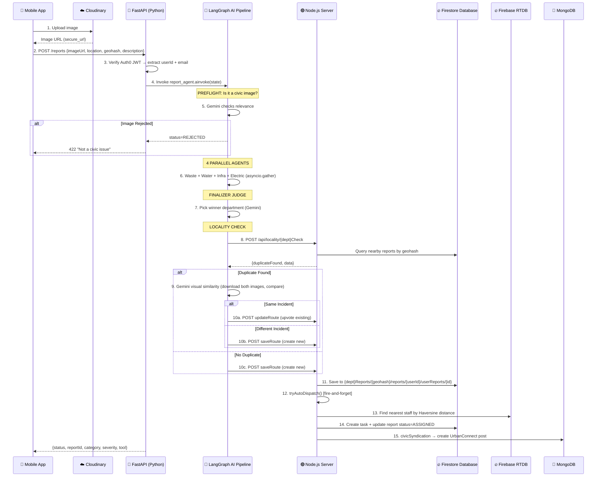

# CivicConnect — Detailed Walkthrough Part 1: Architecture & Server Backend

> This is Part 1 of 3. It covers the high-level architecture, the data flow, and every server-side file.

---

## 1. What is CivicConnect?

CivicConnect is the **AI-powered grievance reporting system** inside UrbanFlow. It lets citizens:
1. Take a photo of a civic issue (pothole, garbage, broken wires, flooding)
2. Submit it from the mobile app
3. Have AI automatically **classify, triage, de-duplicate, and route** the complaint to the correct municipal department
4. Track the issue's lifecycle (Reported → Assigned → In Progress → Resolved)

There is **no manual department selection** by the user — the AI pipeline handles everything.

---

## 2. End-to-End Data Flow

This is the single most important thing to understand. Every interview question traces back to this flow.



---

## 3. Project Structure (CivicConnect-specific files only)

```
UrbanFlow/
├── agents/                          # Python AI service (FastAPI)
│   ├── main.py                      # FastAPI app + /reports endpoint
│   └── brain/civicconnect/          # AI pipeline
│       ├── state.py                 # TypedDict state definition
│       ├── orchestrator.py          # LangGraph main graph
│       ├── utils.py                 # Shared LLM instances, preflight
│       ├── waste_agent.py           # Waste specialist
│       ├── water_agent.py           # Water specialist
│       ├── infra_agent.py           # Infrastructure specialist
│       ├── electric_agent.py        # Electricity specialist
│       ├── finalizer.py             # Judge agent (picks winner)
│       └── locality_check_agent.py  # Dedup subgraph + save/update
│
├── server/                          # Node.js backend (Express)
│   ├── app.js                       # Route registration
│   └── src/
│       ├── routes/
│       │   ├── report.routes.js     # /api/reports/* (save/update/fetch)
│       │   ├── track.route.js       # /api/track/:reportId
│       │   ├── locality.routes.js   # /api/locality/* (dedup queries)
│       │   ├── mapReports.js        # /map-reports (heatmap data + voting)
│       │   └── civicAnalytics.routes.js  # /api/civic-analytics/*
│       ├── controllers/
│       │   ├── aiReports/           # 5 save controllers (one per dept)
│       │   ├── updateReports/       # 5 update controllers (upvote)
│       │   ├── fetchReports/        # fetch3Reports.js (user history)
│       │   ├── report/              # report.controller.js (resolve)
│       │   ├── track/               # track.controller.js (track + confirm/reject)
│       │   └── localityCheck/       # 4 locality check controllers
│       └── services/
│           ├── autoDispatch.js      # Nearest-staff assignment
│           ├── civicSyndication.js  # Bridge to UrbanConnect
│           └── syncReportStatus.js  # Sync status to MongoDB
│
├── client-native/                   # React Native (Expo) mobile app
│   ├── app/(main)/(tabs)/CivicConnect/index.jsx  # Main screen
│   └── components/features/Reports/
│       ├── config.js                # Theme + icon constants
│       ├── ReportForm.jsx           # Image picker + submit form
│       ├── ReportSidebar.jsx        # Form + history sidebar
│       └── ReportMap.jsx            # MapView with issue pins
│
└── client/                          # React.js web dashboard
    └── src/pages/
        ├── CivicHub.jsx             # Admin grievance hub
        └── features/reports/        # Admin report map page
```

---

## 4. Server Files — Explained One by One

### 4.1 [server/app.js](file:///e:/sankalp/UrbanFlow/server/app.js) — The Express App Factory

**Why it exists:** This is the central Express application file. It imports all route modules and mounts them on specific URL paths.

**CivicConnect-relevant mountpoints:**
| Path | Module | Purpose |
|---|---|---|
| `/api/reports` | [report.routes.js](file:///e:/sankalp/UrbanFlow/server/src/routes/report.routes.js) | Save, update, fetch reports |
| `/api/track` | [track.route.js](file:///e:/sankalp/UrbanFlow/server/src/routes/track.route.js) | Track a report by ID |
| `/api/locality` | [locality.routes.js](file:///e:/sankalp/UrbanFlow/server/src/routes/locality.routes.js) | Duplicate-detection queries |
| `/map-reports` | [mapReports.js](file:///e:/sankalp/UrbanFlow/server/src/routes/mapReports.js) | Heatmap data + voting |
| `/api/civic-analytics` | [civicAnalytics.routes.js](file:///e:/sankalp/UrbanFlow/server/src/routes/civicAnalytics.routes.js) | Admin analytics |
| `/api/urbanconnect` | [urbanconnect.route.js](file:///e:/sankalp/UrbanFlow/server/src/routes/urbanconnect.route.js) | Syndication endpoint |

---

### 4.2 [server/src/routes/report.routes.js](file:///e:/sankalp/UrbanFlow/server/src/routes/report.routes.js) — The Report Route Hub

**Why it exists:** Defines all HTTP endpoints for creating, updating, and fetching reports across **all 5 departments**.

**Key routes:**
- `POST /api/reports/waterReports` → [saveWaterReport](file:///e:/sankalp/UrbanFlow/server/src/controllers/aiReports/waterReports.js#4-59) (creates new water report)
- `POST /api/reports/updatewaterReports` → `updateWaterReports` (upvotes existing)
- `POST /api/reports/fetch3Reports` → [fetch3Reports](file:///e:/sankalp/UrbanFlow/server/src/controllers/fetchReports/fetch3Reports.js#3-46) (gets user's 3 latest reports — **requires Auth0 JWT**)
- `PUT /api/reports/resolve` → [resolveReport](file:///e:/sankalp/UrbanFlow/server/src/controllers/report/report.controller.js#3-38) (marks a report as RESOLVED)

> **Interview Tip:** Notice there's a separate save and update route per department. This is because each department's data is stored in a **separate top-level Firestore collection**.

---

### 4.3 `server/src/controllers/aiReports/*.js` — The Save Controllers

Each file ([wasteReports.js](file:///e:/sankalp/UrbanFlow/server/src/controllers/aiReports/wasteReports.js), [waterReports.js](file:///e:/sankalp/UrbanFlow/server/src/controllers/aiReports/waterReports.js), [infraReports.js](file:///e:/sankalp/UrbanFlow/server/src/controllers/aiReports/infraReports.js), [electricityReports.js](file:///e:/sankalp/UrbanFlow/server/src/controllers/aiReports/electricityReports.js), [fireReports.js](file:///e:/sankalp/UrbanFlow/server/src/controllers/aiReports/fireReports.js), [uncertainReports.js](file:///e:/sankalp/UrbanFlow/server/src/controllers/aiReports/uncertainReports.js)) follows the **exact same pattern**:

```
1. Extract userId and geohash from request body
2. Construct Firestore document path:
   {dept}Reports / {geohash} / reports / {userId} / userReports / {auto-id}
3. Save the full report data (including AI analysis)
4. Call tryAutoDispatch() in fire-and-forget mode
5. Return { status: "VERIFIED", reportId }
```

**The Firestore Path Hierarchy (CRITICAL for interviews):**
```
wasteReports/              ← Top-level collection (one per department)
  └── {geohash}/           ← Document keyed by geohash (spatial bucketing)
      └── reports/         ← Sub-collection
          └── {userId}/    ← Document keyed by user
              └── userReports/     ← Sub-collection
                  └── {auto-id}    ← The actual report document
```

**Why this hierarchy?**
- **Geohash first:** Enables fast spatial queries. All reports in a geographic area share the same parent document.
- **userId second:** Groups each user's reports together for [fetch3Reports](file:///e:/sankalp/UrbanFlow/server/src/controllers/fetchReports/fetch3Reports.js#3-46).
- **auto-id last:** Each individual report gets a unique Firestore ID.

---

### 4.4 [server/src/services/autoDispatch.js](file:///e:/sankalp/UrbanFlow/server/src/services/autoDispatch.js) — Intelligent Staff Assignment

**Why it exists:** After a report is saved, this service automatically assigns it to the nearest available field worker.

**Algorithm:**
1. Map department name to RTDB path key (e.g., `infrastructure` → [infra](file:///e:/sankalp/UrbanFlow/agents/brain/civicconnect/infra_agent.py#26-37))
2. **Status Guard:** Check if report is already ASSIGNED/RESOLVED to avoid duplicate dispatches
3. Trim geohash to 6 chars (matches staff registration precision)
4. Read online staff from Firebase RTDB at `staff/{dept}/{geohash6}`
5. Calculate **Haversine distance** from each staff member's GPS to the report's GPS
6. Pick the closest staff member
7. Create a `tasks` document in Firestore with a 24h deadline
8. Update report status to `ASSIGNED`
9. Call `syncReportStatus()` to update the UrbanConnect MongoDB mirror

**Key Design Decisions:**
- **Fire-and-forget:** If dispatch fails, the report stays as `VERIFIED` for manual assignment later. The main flow never blocks.
- **Haversine formula:** Used for accurate spherical distance calculation between two GPS coordinates.

---

### 4.5 [server/src/services/civicSyndication.js](file:///e:/sankalp/UrbanFlow/server/src/services/civicSyndication.js) — Bridge to UrbanConnect

**Why it exists:** Every verified CivicConnect report also appears as a post in the UrbanConnect social feed, so the community can see and discuss civic issues.

**What it does:**
1. Guards against UNCERTAIN reports (don't syndicate unclassified junk)
2. Guards against duplicate syndication (checks if `reportId` already exists in MongoDB)
3. Maps the reporter's email to an UrbanConnect user (`ObjectId`), or falls back to a placeholder
4. Creates a `Question` document in MongoDB with `isCivicReport: true`
5. Clears the Redis feed cache so the new post appears immediately
6. Fires a POST to the Python `/analyze-civic` endpoint for AI sentiment analysis

---

### 4.6 [server/src/controllers/track/track.controller.js](file:///e:/sankalp/UrbanFlow/server/src/controllers/track/track.controller.js) — Report Tracking

**Why it exists:** Lets citizens and staff track the lifecycle of a report.

**Three endpoints:**
1. [trackReport(reportId)](file:///e:/sankalp/UrbanFlow/server/src/controllers/track/track.controller.js#5-27) → Uses Firestore `collectionGroup('userReports')` to find any report by ID across all departments
2. [confirmResolution(taskId, reportId)](file:///e:/sankalp/UrbanFlow/server/src/controllers/track/track.controller.js#28-61) → Citizen confirms the fix. Task → COMPLETED, Report → RESOLVED
3. [rejectResolution(taskId, reportId, reason)](file:///e:/sankalp/UrbanFlow/server/src/controllers/track/track.controller.js#61-98) → Citizen rejects the fix. Task → PENDING (returned for rework), Report → ASSIGNED

> **Interview Tip:** `collectionGroup` is a Firestore query that searches across ALL sub-collections with the same name, regardless of their parent path. This is how a single `reportId` can be found without knowing which department or geohash it belongs to.

---

### 4.7 `server/src/controllers/updateReports/*.js` — Upvote Existing Reports

**Why it exists:** When the AI detects a duplicate report (same location, same issue), instead of creating a new one, it upvotes the existing report and adds the new reporter's email to the `interests` array.

**What it does:**
```javascript
await reportDocRef.update({
  interests: FieldValue.arrayUnion(email),   // Add reporter to interested parties
  upvotes: FieldValue.increment(1),          // Increase visibility
  updatedAt: serverTimestamp()
});
```

---

### 4.8 [server/src/controllers/fetchReports/fetch3Reports.js](file:///e:/sankalp/UrbanFlow/server/src/controllers/fetchReports/fetch3Reports.js) — User History

**Why it exists:** Shows the user their 3 most recent reports on the mobile app sidebar.

Uses `collectionGroup('userReports').where('userId', '==', userId).orderBy('createdAt', 'desc').limit(3)`.

---

### 4.9 [server/src/routes/locality.routes.js](file:///e:/sankalp/UrbanFlow/server/src/routes/locality.routes.js) — Duplicate Detection Backend

**Why it exists:** The Python AI pipeline calls these endpoints during the locality check phase to query if a similar report already exists nearby.

**4 endpoints** (one per department):
- `POST /api/locality/waterCheck`
- `POST /api/locality/wasteCheck`
- `POST /api/locality/infraCheck`
- `POST /api/locality/electricityCheck`

Each receives `{location, geohash, userId}` and queries Firestore for nearby reports within the same geohash zone.

---

### 4.10 [server/src/routes/mapReports.js](file:///e:/sankalp/UrbanFlow/server/src/routes/mapReports.js) — Heatmap & Voting

**Why it exists:** Powers the issue heatmap on the mobile map view and the admin dashboard.

- `GET /map-reports` → Fetches all reports from all departments using `collectionGroup('userReports')` + archived fire reports
- `POST /map-reports/vote` → Upvote/downvote a report by its Firestore document path

---

### 4.11 [server/src/routes/civicAnalytics.routes.js](file:///e:/sankalp/UrbanFlow/server/src/routes/civicAnalytics.routes.js) — Admin Intelligence

**Why it exists:** Powers the Civic Intelligence Dashboard for administrators.

**Endpoints:**
| Endpoint | Purpose |
|---|---|
| `GET /sentiment-stats?days=7` | Aggregated sentiment/urgency/postType counts from MongoDB |
| `GET /emerging-issues` | Active clusters with post counts (grouped by `aiAnalysis.clusterId`) |
| `GET /misinformation?limit=20` | Posts flagged as misinformation |
| `GET /posts?page=1&limit=20` | Paginated AI-analyzed posts for admin table |
| `GET /cluster/:clusterId` | Detailed breakdown of a specific issue cluster |
| `POST /cluster/:clusterId/summarize` | Trigger AI summary generation for a cluster |

---

### 4.12 [server/src/controllers/report/report.controller.js](file:///e:/sankalp/UrbanFlow/server/src/controllers/report/report.controller.js) — Resolve Report

Simple controller that finds a report by ID via `collectionGroup` and sets its status to `RESOLVED`.

---

## 5. Quick-Fire Interview Q&A (Server)

**Q: Why use Firestore for reports instead of MongoDB?**
A: Reports need **real-time subscriptions** (staff dashboards update live), **geohash-based spatial indexing**, and a hierarchical structure that maps naturally to Firestore's nested collections.

**Q: What is a collectionGroup query?**
A: A Firestore query that searches across ALL sub-collections with the same name, at any depth. It's how [trackReport](file:///e:/sankalp/UrbanFlow/server/src/controllers/track/track.controller.js#5-27) finds a report without knowing its department or geohash.

**Q: Why is autoDispatch fire-and-forget?**
A: Because the primary goal is to SAVE the report reliably. Auto-dispatch is an optimization. If it fails (no staff online, GPS missing), the report stays as VERIFIED for manual assignment later — it never blocks the user.

**Q: How does the upvote/duplicate system work?**
A: The AI detects duplicates during the locality check. If the same issue already exists, instead of creating a new report, it adds the new reporter to the `interests` array and increments `upvotes`. Higher upvotes → higher visibility on the admin dashboard.
