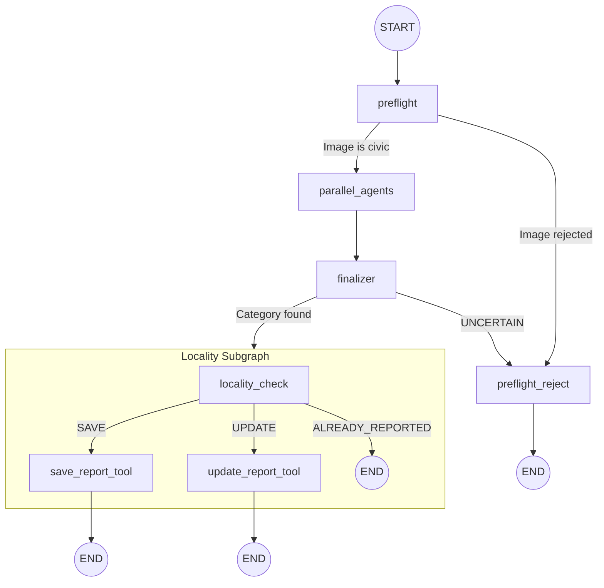

# CivicConnect — Detailed Walkthrough Part 2: The AI Pipeline (Python/LangGraph)

> Part 2 of 3. Covers every file inside `agents/brain/civicconnect/` and the FastAPI `/reports` endpoint in `agents/main.py`.

---

## 1. Overview: The Multi-Agent Architecture

CivicConnect uses **LangGraph** (a state-machine framework built on LangChain) to orchestrate an AI pipeline with **6 nodes**. Here is the graph:



---

## 2. File-by-File Deep Dive

### 2.1 `state.py` — The State Schema

**Why it exists:** LangGraph requires a TypedDict that defines ALL data that flows through the pipeline. Every node reads from and writes to this shared state.

**Key fields:**

| Field Group | Fields | Purpose |
|---|---|---|
| **Input** | `userId`, `email`, `imageUrl`, `location`, `address`, `description`, `geohash`, `status` | Data from the mobile app |
| **Preflight** | `preflight_passed`, `preflight_hint`, `preflight_rejection_reason` | Populated by preflight node |
| **Agent Analysis** | `water_analysis`, `waste_analysis`, `infra_analysis`, `electric_analysis` | Each agent writes its `AgentAnalysis` here |
| **Judge Output** | `aiAnalysis`, `severity`, `assigned_category`, `title`, `route`, `updatedRoute` | Finalizer populates these |
| **Locality** | `tool` (SAVE/UPDATE/ALREADY_REPORTED), `locality_imageUrl`, `locality_email`, `locality_userId`, `locality_reportId` | Populated by locality check |
| **Output** | `reportId` | Final report ID after save |

**Important types:**
- `SeverityLevel`: Enum — `LOW`, `MEDIUM`, `HIGH`, `CRITICAL`
- `ReportStatus`: Enum — `INITIATED`, `VERIFIED`, `ASSIGNED`, `RESOLVED`, `REJECTED`  
- `ReportCategory`: Enum — `WATER`, `INFRASTRUCTURE`, `WASTE`, `ELECTRICITY`, `UNCERTAIN`
- `AgentAnalysis`: Pydantic model — `{confidence, severity, reasoning, title}`

> **Interview Tip:** The state is a flat dict, not nested. Each node returns only the keys it wants to update. LangGraph merges updates automatically.

---

### 2.2 `utils.py` — Shared AI Utilities

**Why it exists:** Contains all shared LLM instances, the preflight check, and the core `analyze_image_category()` function used by all 4 domain agents.

**Key components:**

#### LLM Instances
```python
llm = ChatGoogleGenerativeAI(model="gemini-2.0-flash", temperature=0)
preflight_llm = ChatGoogleGenerativeAI(model="gemini-2.0-flash", temperature=0, max_retries=1)
```
Both use **Gemini 2.0 Flash** — a fast, cheap model ideal for classification tasks. `temperature=0` means deterministic output (no randomness).

#### Structured Output (No JSON Parsing!)
```python
structured_agent_llm = llm.with_structured_output(AgentOutput)
```
This tells LangChain to force the LLM to return data matching the `AgentOutput` Pydantic schema. **No JSON.parse() needed** — LangChain handles schema validation automatically.

#### `AgentOutput` Schema
```python
class AgentOutput(BaseModel):
    title: str         # "Overflowing dumpster near park"
    confidence: float  # 0.0 to 1.0
    severity: SeverityLevel  # LOW/MEDIUM/HIGH/CRITICAL
    reasoning: str     # "Visible pile of garbage blocking drain"
```

#### `analyze_image_category()` — The Core Function
Every domain agent calls this. It:
1. Builds a `HumanMessage` with both **text** and **image_url** (multimodal)
2. Prepends the `GLOBAL_CONTEXT` (explains the 4-agent system to the LLM)
3. Appends the agent-specific `system_prompt`
4. Calls the LLM with retry logic (3 attempts, exponential backoff)
5. Returns an `AgentAnalysis` result

#### `image_preflight()` — The Gatekeeper
A fast check BEFORE running the expensive 4-agent pipeline:
- **REJECT:** selfies, indoor photos, screenshots, blurry images
- **APPROVE:** any outdoor civic issue
- Returns `PreflightResult(is_civic_issue=bool, civic_category_hint=str, rejection_reason=str)`
- On failure, **defaults to APPROVE** (always fail-open, never lose a legitimate report)

---

### 2.3 The 4 Domain Agents

Each agent is a single file with a single function. They all follow the same pattern:

```python
async def {agent}_agent_node(state: AgentState) -> dict:
    result = await analyze_image_category(
        image_url=state["imageUrl"],
        system_prompt=AGENT_SYSTEM_PROMPT,
        user_description=state.get("description", "")
    )
    return {"{agent}_analysis": result}
```

What differs is the **system prompt**. Each prompt defines:
1. **Jurisdiction** — what this agent IS responsible for
2. **Boundaries** — what belongs to OTHER agents (prevents overlap)
3. **Severity scale** — what constitutes LOW/MEDIUM/HIGH/CRITICAL

#### `waste_agent.py` — Waste Management Specialist
- Jurisdiction: Overflowing bins, litter, construction debris, burning garbage, plastic pollution
- NOT: Potholes (infra), flooding (water), hanging wires (electric)
- CRITICAL example: Bio-waste, burning garbage, massive dump blocking road

#### `water_agent.py` — Hydrology Engineer
- Jurisdiction: Flooding, sewage, pipe leaks, stagnant water, polluted water bodies
- NOT: Dry potholes (infra), dry garbage piles (waste)
- Key rule: "If garbage is blocking a drain causing a FLOOD → report it" (cross-boundary exception)

#### `infra_agent.py` — Civil Engineer
- Jurisdiction: Potholes, sinkholes, cracked roads, broken sidewalks, damaged bus stops, fallen trees
- NOT: Hanging wires (electric), trash (waste), water (water unless structurally related)
- CRITICAL example: Massive sinkhole, missing manhole cover on main road

#### `electric_agent.py` — Electrical Safety Inspector
- Jurisdiction: Hanging wires, leaning utility poles, sparking equipment, non-functional streetlights
- NOT: Structural poles without wires (infra), rubber tubes on ground (waste)
- Key rule: "If unsure between harmless fiber cable and dangerous power line → assume HIGH risk"

> **Interview Tip:** The confidence score is NOT "do I see something" — it's "is this MY department's responsibility". A waste agent seeing a pothole should score 0.1, not 0.8.

---

### 2.4 `finalizer.py` — The Judge Agent

**Why it exists:** After all 4 agents run in parallel, their results might conflict. The finalizer is the "City Operations Supervisor" that makes the final call.

**Decision Process:**
1. **Fast path:** If ALL agents score below 0.35 → `UNCERTAIN` (skip the LLM call entirely)
2. **Normal path:** Build a context string with all 4 agents' results + preflight hint → ask Gemini to pick ONE winning department
3. **Fallback:** If the judge LLM fails → pick the agent with the highest confidence score

**Overlap Resolution Rules (from the prompt):**
| Ambiguous Scenario | Winner |
|---|---|
| "Water on road" | WATER |
| "Trash in drain causing flood" | WASTE (root cause) |
| "Broken streetlight" | ELECTRICITY |
| "Structural pole with no wires" | INFRASTRUCTURE |
| "Open manhole, no water" | INFRASTRUCTURE |

**Route Mapping:**
After picking a category, the finalizer maps it to a Node.js backend URL:
```python
ROUTE_MAPPING = {
    WATER:          "reports/waterReports",
    WASTE:          "reports/wasteReports",
    INFRASTRUCTURE: "reports/infrastructureReports",
    ELECTRICITY:    "reports/electricityReports",
    UNCERTAIN:      "reports/uncertainReports",
}
```

---

### 2.5 `orchestrator.py` — The Master Graph

**Why it exists:** Assembles all nodes into a LangGraph `StateGraph` with conditional routing.

**The 5 nodes:**
1. `preflight` — Calls `image_preflight()` → sets `preflight_passed`
2. `parallel_agents` — Runs all 4 domain agents via `asyncio.gather` (TRUE parallelism)
3. `finalizer` — Picks the winning category
4. `preflight_reject` — Sets status=REJECTED for non-civic images
5. `submission_process` — Runs the locality subgraph

**Routing logic:**
```python
# After preflight
if preflight_passed → parallel_agents
else → preflight_reject

# After finalizer
if category == UNCERTAIN → preflight_reject
else → submission_process
```

> **Interview Tip:** `asyncio.gather` is critical here. LangGraph's built-in fan-out doesn't natively parallelize. By wrapping 4 async coroutines in `gather`, all agents run simultaneously — reducing latency from 4× to 1× the single-agent time.

---

### 2.6 `locality_check_agent.py` — The Dedup + Save Subgraph

**Why it exists:** This is a **separate LangGraph subgraph** that handles:
1. Checking if a similar report already exists nearby
2. If yes, verifying visual similarity using Gemini
3. Deciding to SAVE (new), UPDATE (upvote existing), or reject (ALREADY_REPORTED)
4. Actually making the HTTP call to the Node.js backend to persist the report

**The 3-node subgraph:**
```
START → locality_check → [route] → save_report_tool OR update_report_tool → END
                    ↓
               ALREADY_REPORTED → END
```

#### `locality_check_agent()` — Node 1
1. Calls the Node.js backend: `POST /api/locality/{dept}Check`
2. Backend queries Firestore for nearby reports in the same geohash zone
3. If `duplicateFound: true`:
   - Downloads BOTH images (new + existing) concurrently using `asyncio.gather`
   - Sends both images to Gemini: "Do these show the EXACT SAME incident?"
   - If visually same + same user → `ALREADY_REPORTED`
   - If visually same + different user → `UPDATE` (upvote)
   - If visually different → `SAVE` (new report)
4. If no duplicate → `SAVE`

#### `save_report_tool()` — Node 2a
1. Builds the full payload (all fields + AI analysis + timestamps)
2. POSTs to the correct Node.js route (e.g., `/api/reports/waterReports`)
3. **Fire-and-forget syndication:** Creates an async task to POST to `/api/urbanconnect/syndicate-civic` so the report also appears in the social feed

#### `update_report_tool()` — Node 2b
POSTs to the update route (e.g., `/api/reports/updatewaterReports`) to add the new reporter as an interested party.

---

### 2.7 `agents/main.py` — The FastAPI Entry Point

**Why it exists:** This is the Python web server that the mobile app calls. The `/reports` endpoint is the gateway to the entire AI pipeline.

**`POST /reports` flow:**
1. **Auth:** `Depends(get_user_from_token)` — extracts `userId` and `email` from the Auth0 JWT by calling Auth0's `/userinfo` endpoint
2. **State init:** Builds the full `AgentState` dict with all fields initialized to `None`
3. **Invoke:** `result = await report_agent.ainvoke(initial_state)` — runs the entire LangGraph pipeline
4. **Response handling:**
   - If `status == REJECTED` → return `422` (not a civic issue)
   - If `reportId` exists → return `200` with `{reportId, category, severity, tool}`
   - Else → return `{status: "partial_success"}` (analysis worked but save might have failed)

---

## 3. Quick-Fire Interview Q&A (AI Pipeline)

**Q: Why use 4 parallel agents instead of 1 multi-label classifier?**
A: Each agent has deep domain expertise with specific jurisdictional boundaries. Running them in parallel with a judge gives more accurate results than a single model trying to handle all categories. It also provides explainability — you can see each agent's reasoning.

**Q: What happens if Gemini is down or rate-limited?**
A: Every LLM call has `tenacity` retry logic (3 attempts with exponential backoff). If all retries fail, each agent returns a default `AgentAnalysis` with `confidence=0.0`. The finalizer falls back to picking the highest confidence score. The preflight defaults to APPROVE. The system never crashes.

**Q: Why is preflight a separate step from the 4 agents?**
A: Cost and latency. The 4-agent pipeline makes 4 LLM calls + 1 judge call = 5 API calls. Preflight makes 1 cheap call to reject obvious spam (selfies, indoor photos) BEFORE burning 5 API calls on junk images.

**Q: How does visual duplicate detection work?**
A: The locality check downloads both images concurrently, then sends them to Gemini with the prompt: "Do these show the EXACT SAME specific incident (same location, same problem)? Respond TRUE or FALSE." This prevents upvoting unrelated issues just because they're geographically close.

**Q: What does `asyncio.gather(return_exceptions=True)` do?**
A: It runs all 4 agent coroutines concurrently. `return_exceptions=True` means if one agent throws an error, the others still complete successfully. Failed agents return an `Exception` object instead of crashing the whole pipeline.

**Q: What is structured output in LangChain?**
A: `llm.with_structured_output(PydanticModel)` forces the LLM to return JSON that exactly matches the Pydantic schema. LangChain validates it automatically. No `JSON.parse()`, no regex extraction, no schema mismatches.

**Q: Why does the finalizer have a MIN_CONFIDENCE_THRESHOLD of 0.35?**
A: If no agent is even 35% confident, the image is genuinely ambiguous. Rather than force a wrong classification, it's better to mark it UNCERTAIN and let a human admin review it.
