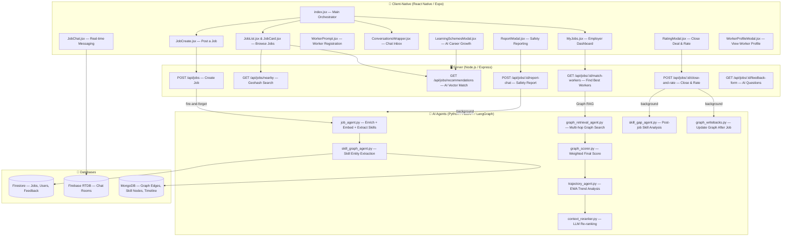

# StreetGig Feature — Part 1: Architecture & Client-Native

> **What is this?** A comprehensive interview-ready walkthrough of the **StreetGig** feature inside UrbanFlow. Read this before any interview or architecture discussion. Nothing is left out.

---

## 1. One-Line Summary

**StreetGig is a hyperlocal, AI-powered gig marketplace** that connects employers who need on-demand blue-collar services (plumbers, carpenters, etc.) with nearby workers — using **geohash-based proximity search**, **vector-embedding AI matching**, **Graph RAG (Retrieval-Augmented Generation) scoring**, and a **real-time Firebase chat** system.

---

## 2. The Big Picture



---

## 3. The Three Databases — Why Three?

| Database | Type | What It Stores | Why This DB? |
|---|---|---|---|
| **Firestore** | Document DB | Jobs, Users, Feedback forms, Chat reports | Structured data, robust querying, vector fields (`FieldValue.vector`), Auth integration |
| **Firebase RTDB** | Real-time JSON | Chat rooms (`jobs/rooms/`), messages, typing indicators, presence, `lastRead` | Sub-second sync for live chat, no polling needed, `onValue` listeners |
| **MongoDB** | Graph-like Document Store | `graph_edges` (worker→skill, worker→employer), [skill_nodes](file:///Users/aryangupta/Documents/Projects/UrbanFlow/agents/brain/streetgig/skill_graph_agent.py#57-77), `skill_timeline` | Flexible schema for graph traversal, `$in` queries on arrays, time-series for EWA |

> [!IMPORTANT]
> **Interview Question:** "Why not just use Firestore for everything?"
> **Answer:** Firestore charges per read and doesn't support graph traversal natively. The Graph RAG pipeline does multi-hop queries (exact match → adjacent skills → repeat-hire) that would be expensive and slow in Firestore. MongoDB's flexible `$in` and aggregation pipeline make it ideal for graph-style queries. Firebase RTDB is used for chat because it has built-in real-time sync with `onValue`—Firestore's `onSnapshot` would work but RTDB is faster for high-frequency small writes (messages).

---

## 4. Client-Native — File-by-File Breakdown

Every file lives in: `client-native/app/(main)/(tabs)/StreetGig/`

---

### 4.1 [index.jsx](file:///Users/aryangupta/Documents/Projects/UrbanFlow/client-native/app/(main)/(tabs)/StreetGig/index.jsx) — The Brain (495 lines)

**Purpose:** Central orchestrator. Manages ALL state, routing between sub-views, and data fetching.

**Key State Variables:**

| State | Type | Purpose |
|---|---|---|
| `activeTab` | `'ALL' \| 'MY' \| 'CREATE'` | Which sub-tab (list view) is active |
| `mobileTab` | `'list' \| 'chat'` | Top-level navigation — job list vs chat |
| `userProfile` | `object` | Cached user profile from `/api/user/profile` |
| `showWorkerPrompt` | `bool` | Controls WorkerPrompt modal visibility |
| `showLearningSchemes` | `bool` | Controls LearningSchemesModal visibility |
| `jobs` | `array` | Current job listings (nearby OR recommended) |
| `myJobs` | `array` | Jobs posted by the current user |
| `selectedJob` | `object` | Currently selected job for chat |
| `userLocation` | `{lat, lng}` | GPS coordinates from `expo-location` |
| `timeFilter`, `minPriceFilter` | `string` | Recommendation filters |

**Critical Data Flow:**

1. **On mount** → Gets GPS via `expo-location` → stores in `userLocation`
2. **If worker mode ON** → Calls `GET /api/jobs/recommendations` (vector-matched) → `jobs`
3. **If worker mode OFF** → Calls `GET /api/jobs/nearby` (geohash-only) → `jobs`
4. **Profile check** → If `hasSeenWorkerPrompt === false` → shows `WorkerPrompt`
5. **Worker toggle** → `handleToggleWorker()` → `PATCH /api/user/worker-interest`

**Why TWO navigation layers?**
- `mobileTab` = pill navigation (bottom) → switches between "list" and "chat" views
- `activeTab` = inline tabs (inside list) → ALL / MY / CREATE

**Key Functions:**

- `selectJobAndJoin(job, worker)` → Creates an RTDB chat room with a deterministic ID: `{jobId}_chat_{sortedParticipants}`. Sets up `members`, `jobMeta` in a single `update()` call.
- `handleStartWorkerChat(job)` → Worker-initiated chat. Same room creation logic. The room ID is deterministic so two people can't create duplicate rooms.

> [!TIP]
> **Interview Question:** "How do you prevent duplicate chat rooms?"
> **Answer:** The `chatRoomId` is deterministically generated: `${jobId}_chat_${sorted([employerId, workerId]).join('_')}`. Since participants are sorted alphabetically, swapping roles produces the same room ID.

---

### 4.2 [JobCreate.jsx](file:///Users/aryangupta/Documents/Projects/UrbanFlow/client-native/app/(main)/(tabs)/StreetGig/JobCreate.jsx) — Multi-Step Job Wizard (295 lines)

**Purpose:** 4-step wizard for posting a job.

**Steps:**
| Step | What User Does | State |
|---|---|---|
| 0 | Select category (30 categories, grid layout) | `category` |
| 1 | Set budget (₹ input + quick-pick buttons) | `amount` |
| 2 | Select time slot (6 options) | `time` |
| 3 | Describe requirements + optional recommendation tag | `description`, `recommendation` |

**On "Post Job"** → `POST /api/jobs` → Server responds instantly ("AI enriching in background") → Fires `job_agent.py` in a fire-and-forget IIFE.

**Progress bar** is animated: `width: ${((currentStep + 1) / 4) * 100}%`.

> [!NOTE]
> The `recommendation` field (e.g. "Urgent Fix", "Quality First") is an employer hint passed to the AI enrichment agent to generate a more contextual description.

---

### 4.3 [JobList.jsx](file:///Users/aryangupta/Documents/Projects/UrbanFlow/client-native/app/(main)/(tabs)/StreetGig/JobList.jsx) + [JobCard.jsx](file:///Users/aryangupta/Documents/Projects/UrbanFlow/client-native/app/(main)/(tabs)/StreetGig/JobCard.jsx) — Browsing Jobs (74 + 98 lines)

**JobList** = Container. Shows a loading animation (pulsing sparkle icon) or renders a `ScrollView` of `JobCard`s.

**JobCard** = Single job tile. Shows:
- Category name, description (2-line truncated)
- Time slot + distance (Haversine-computed on server)
- Budget (₹ amount)
- "AI Match" chip if recommendation exists
- "Message Employer" button → triggers `handleStartWorkerChat`

> [!TIP]
> `isAiMatching` prop shows different loading text: "AI is finding best jobs..." vs "Finding local opportunities..."

---

### 4.4 [MyJobs.jsx](file:///Users/aryangupta/Documents/Projects/UrbanFlow/client-native/app/(main)/(tabs)/StreetGig/MyJobs.jsx) — Employer Dashboard (200 lines)

**Purpose:** Lists all jobs the employer has posted. Each card has a **"Find Workers"** expandable section.

**Key Flow:**
1. Employer taps "Find Workers" → calls `GET /api/jobs/:id/match-workers`
2. Server tries **Graph RAG first** (if skills exist) → Falls back to **vector cosine similarity**
3. Results show: name, rating, completed jobs, `match_reason` (from LLM re-ranker)
4. Employer taps chat icon → opens chat with that worker

**Design Detail:** A minimum 2-second `Promise.all` with `setTimeout(resolve, 2000)` ensures the AI loading animation plays fully — prevents a jarring instant result.

**`AiLoadingAnimation`** component uses `react-native-reanimated` `withRepeat` + `withTiming` for a smooth pulsing sparkle.

---

### 4.5 [WorkerPrompt.jsx](file:///Users/aryangupta/Documents/Projects/UrbanFlow/client-native/app/(main)/(tabs)/StreetGig/WorkerPrompt.jsx) — Worker Registration (198 lines)

**Purpose:** Bottom sheet modal for workers to register. Collects:
- **Skills** (multi-select from 30 categories)
- **Years of experience** (number input)
- **Description** ("About your services")

**On Save** → `PATCH /api/user/worker-interest` with `{ interestedToWork: true, workerCategories, experience, description }`. 

Backend then generates a `master_string_embedded` vector from the combined text — used for cosine similarity matching.

---

### 4.6 [ConversationsWrapper.jsx](file:///Users/aryangupta/Documents/Projects/UrbanFlow/client-native/app/(main)/(tabs)/StreetGig/ConversationsWrapper.jsx) — Chat Inbox (331 lines)

**Purpose:** Unified chat inbox with two views: **"As Employer"** and **"As Worker"**.

**Data Architecture:**

| Source | What | How |
|---|---|---|
| REST API | `GET /api/jobs/my` → `myJobs` | Employer's posted jobs |
| Firebase RTDB | `onValue(ref(db, 'jobs/rooms'))` → `allRooms` | ALL chat rooms in real-time |

**Employer View (`employerChats`):**
- Groups rooms by job → shows which workers have messaged
- Expandable: tap a job → see all worker chats underneath
- Unread badge computed from `lastRead[userId]` timestamp

**Worker View (`workerChats`):**
- Flat list of rooms where user participates but DIDN'T post the job
- Shows employer name, job metadata (amount, time, category)
- Filtered by: `!myJobs.some(j => roomId.startsWith(j.id + '_chat_'))`

> [!IMPORTANT]
> **Edge Case Fixed:** `roomData.members` can be `undefined` for partially-initialized rooms. The code now uses `roomData.members || {}` and filters out rooms without members in the `filter()` step.

---

### 4.7 [JobChat.jsx](file:///Users/aryangupta/Documents/Projects/UrbanFlow/client-native/app/(main)/(tabs)/StreetGig/JobChat.jsx) — Real-Time Messaging (340 lines)

**Purpose:** Full-featured chat screen with presence indicators and job management.

**Features:**
| Feature | Implementation |
|---|---|
| Messages | `onValue(ref(db, 'jobs/rooms/{roomId}/messages'))` — real-time |
| Typing indicator | `set(ref(...typing/{myId}), true)` with 2-second auto-clear |
| Online presence | `set(ref(...presence/{myId}), {online: true})` + `onDisconnect()` fallback |
| Job info bar | Collapsible pill showing ₹amount, time, category, status |
| Close Deal | Employer-only button → opens `RatingModal` |
| Report | Opens `ReportModal` → AI safety analysis |
| Closed state | Input replaced with "This conversation is closed" text |

**Message Format:**
```json
{
  "text": "Hello",
  "userId": "auth0|xxx",
  "userName": "Aryan",
  "userAvatar": "https://...",
  "timestamp": serverTimestamp()
}
```

---

### 4.8 [RatingModal.jsx](file:///Users/aryangupta/Documents/Projects/UrbanFlow/client-native/app/(main)/(tabs)/StreetGig/RatingModal.jsx) — Close Deal & Rate (241 lines)

**Purpose:** 4-step feedback wizard (3 star ratings + 1 text comment).

**Flow:**
1. Opens → Fetches AI-generated questions from `GET /api/jobs/:id/feedback-form`
2. Steps 0-2: Star ratings (1–5) with auto-advance on tap
3. Step 3: Text description (employer's comment about the work)
4. Submit → `POST /api/jobs/:id/close-and-rate` with `{ ratings, workerId, pairedQuestions }`

**What happens on the server (fire-and-forget):**
- Closes the job (`status: "CLOSED"`)
- Updates worker rating (running average with Firestore transaction)
- Locks ALL RTDB chat rooms for this job
- Runs **skill_gap_agent.py** → generates skill gap string → embeds into vector DB
- Runs **graph_writebacks.py** → updates worker→skill, worker→employer edges in MongoDB

> [!NOTE]
> The `pairedQuestions` array contains both the question text AND the rating/comment — this gives the AI full context to generate meaningful skill gap analysis.

---

### 4.9 [ReportModal.jsx](file:///Users/aryangupta/Documents/Projects/UrbanFlow/client-native/app/(main)/(tabs)/StreetGig/ReportModal.jsx) — Safety Reporting (89 lines)

**Purpose:** Report inappropriate behavior in chat. 

**Flow:** User writes description → Submit → `POST /api/jobs/:id/report-chat`. Server saves report as `PENDING_AI` → fires `safety_agent.py` in background → AI analyzes chat logs → updates severity (LOW/MEDIUM/HIGH/CRITICAL). If severity ≥ HIGH → writes a `trust_flag` edge to the graph (via `graph_writebacks.py`).

---

### 4.10 [LearningSchemesModal.jsx](file:///Users/aryangupta/Documents/Projects/UrbanFlow/client-native/app/(main)/(tabs)/StreetGig/LearningSchemesModal.jsx) — AI Career Growth (254 lines)

**Purpose:** Shows AI-recommended government skill development schemes.

**Two Tabs:**
| Tab | Source | Logic |
|---|---|---|
| **Upgradation** | Worker's current `workerCategories` + `master_string_embedded` | Cosine similarity against scheme embeddings |
| **Improvement** | `skill_gap_string` + `skill_gap_embeddings` from completed jobs | Vector similarity of identified weaknesses vs. schemes |

Each scheme card shows: title, provider, duration, eligibility, benefits, and a **"X% Match"** badge.

---

### 4.11 [WorkerProfileModal.jsx](file:///Users/aryangupta/Documents/Projects/UrbanFlow/client-native/app/(main)/(tabs)/StreetGig/WorkerProfileModal.jsx) — View Worker Profile (95 lines)

**Purpose:** Bottom sheet showing a worker's profile when employer taps on them in the "Find Workers" list.

Shows: avatar, name, rating (star badge), completed jobs count, and description.

---

## 5. Data Flow Summary — The Complete User Journey

```
EMPLOYER POSTS JOB
  └→ POST /api/jobs (saves to Firestore with geohash)
  └→ Fire-and-forget: job_agent.py
      ├→ enrich_job_data (LLM generates rich description)
      ├→ generate_feedback_form (LLM generates custom questions)  [PARALLEL]
      ├→ extract_job_skills (LLM extracts skill entities)        [SEQUENTIAL after enrich]
      └→ generate_embedding (Gemini embedding model → 768-dim vector) [SEQUENTIAL after skills]
      └→ Updates Firestore: job_embedding, enriched_description, extracted_skills

WORKER BROWSES JOBS
  └→ GET /api/jobs/recommendations
      ├→ 9 geohash6 cells (center + 8 neighbors) → single Firestore query
      ├→ Filter: category match, time match, budget match, not own job
      ├→ Score: cosine_similarity(worker.master_string_embedded, job.job_embedding)
      └→ Sort: nearest first; if dist < 2km, sort by similarity

EMPLOYER FINDS WORKERS
  └→ GET /api/jobs/:id/match-workers
      ├→ TRY: Graph RAG (POST /graph-match)
      │   ├→ graph_retrieval_agent → exact + adjacent + repeat-hire candidates
      │   ├→ graph_scorer → weighted score (0.4 vector + 0.3 graph + 0.2 reputation + 0.1 recency)
      │   ├→ trajectory_agent → EWA trend (improving/stable/declining)
      │   ├→ context_reranker → LLM generates match_reason
      │   └→ Returns ranked candidates with explanations
      └→ FALLBACK: Vector cosine similarity (if no graph data yet)

CHAT NEGOTIATION
  └→ RTDB: jobs/rooms/{jobId}_chat_{sorted_participants}
      ├→ members/{userId} — presence, name, avatar
      ├→ messages/{pushId} — text, timestamp  
      ├→ typing/{userId} — boolean (2s auto-clear)
      ├→ presence/{userId} — online status + onDisconnect fallback
      └→ lastRead/{userId} — timestamp for unread count

DEAL CLOSED & RATED
  └→ POST /api/jobs/:id/close-and-rate
      ├→ Firestore: job.status = "CLOSED"
      ├→ Firestore transaction: update worker rating (running average)
      ├→ RTDB: lock all rooms for this job (status: "closed")
      ├→ Background: skill_gap_agent.py → skill_gap_string + embedding
      ├→ Background: graph_writebacks.py
      │   ├→ worker→skill edges (has_skill, weight = rating)
      │   ├→ worker→employer edge (completed_for, repeat_count++)
      │   ├→ skill_node avg_rating update
      │   └→ skill_timeline time-series record
      └→ Next time employer matches: graph has MORE data → better matches
```
