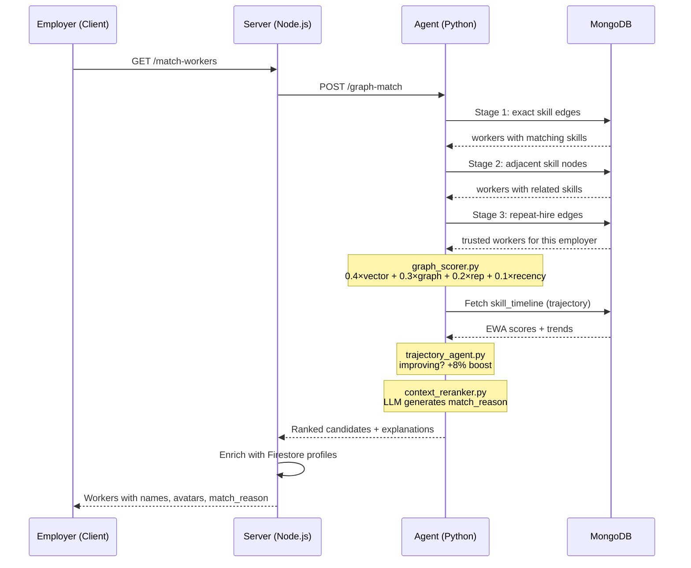

# StreetGig Feature — Part 2: Backend, AI Agents & Graph RAG

---

## 6. Server Backend — [job.route.js](file:///Users/aryangupta/Documents/Projects/UrbanFlow/server/src/routes/job.route.js) (700 lines)

All endpoints are mounted at `/api/jobs` via Express Router.

---

### 6.1 `POST /` — Create Job

**Auth:** `checkJwt` (Auth0 middleware)

**Input:** `{ description, amount, time, location: {lat, lng}, category, recommendation }`

**Flow:**
1. Validates all fields (amount must be positive integer)
2. Generates [geohash](file:///Users/aryangupta/Documents/Projects/UrbanFlow/agents/brain/vyomai/tools/civic.py#166-197) (precision 4) and `geohash6` (precision 6) from [(lat, lng)](file:///Users/aryangupta/Documents/Projects/UrbanFlow/agents/brain/vyomai/tools/_http.py#16-25) using `ngeohash`
3. Saves to Firestore [jobs](file:///Users/aryangupta/Documents/Projects/UrbanFlow/agents/brain/vyomai/tools/streetgig.py#153-166) + creates `jobChats` document **in parallel** (`Promise.all`)
4. Responds to client **immediately** — "AI is enriching in background"
5. **Fire-and-forget IIFE** calls `POST {AGENT_URL}/process-job`:
   - Receives `job_embedding`, `enriched_description`, `extracted_skills`, [feedback_form](file:///Users/aryangupta/Documents/Projects/UrbanFlow/agents/brain/streetgig/job_agent.py#127-155)
   - Updates Firestore: `job_embedding` stored as `FieldValue.vector()` for native vector search
   - Creates `jobFeedback` document with AI-generated questions

> [!IMPORTANT]
> **Why two geohash precisions?**
> - [geohash](file:///Users/aryangupta/Documents/Projects/UrbanFlow/agents/brain/vyomai/tools/civic.py#166-197) (precision 4, ~39km cells) → Used by `GET /nearby` for broad proximity search
> - `geohash6` (precision 6, ~1.2km cells) → Used by `GET /recommendations` for fine-grained AI matching
>
> Precision 6 with `ngeohash.neighbors()` gives exactly 9 cells (center + 8 surrounding) = ~3.6km radius. This fits the "walk/bike to the job" radius perfectly for hyperlocal gigs.

---

### 6.2 `GET /nearby` — Simple Geohash Search

**Auth:** None (public)

**Input:** `?lat=...&lng=...`

**Logic:** Encodes [(lat, lng)](file:///Users/aryangupta/Documents/Projects/UrbanFlow/agents/brain/vyomai/tools/_http.py#16-25) to geohash precision 4 → Gets 8 neighbors → Queries Firestore for `status == "OPEN"` jobs in those 9 geohash cells.

**Used when:** Worker mode is OFF — shows all open jobs without AI matching.

---

### 6.3 `GET /recommendations` — AI Vector Matching

**Auth:** `checkJwt`

**Input:** `?lat=...&lng=...&time=...&minPrice=...`

**Logic (5 stages):**
1. Fetch user profile → get `workerCategories` and `master_string_embedded`
2. Query Firestore: 9 geohash6 cells, `status == "OPEN"` (single `where('geohash6', 'in', hashes)`)
3. In-memory filtering: category match, time filter, budget filter, exclude own jobs
4. Score: [cosineSimilarity(worker_master_embedding, job_embedding)](file:///Users/aryangupta/Documents/Projects/UrbanFlow/server/src/routes/job.route.js#165-179) — both are 768-dim Gemini embeddings
5. Sort: distance-first; if distance diff < 2km, sort by similarity (AI relevance wins for nearby jobs)

> [!WARNING]
> **Firestore limitation:** Only ONE [in](file:///Users/aryangupta/Documents/Projects/UrbanFlow/client-native/app/%28main%29/%28tabs%29/SisterHood/_components/SOSBottomBar.jsx#97-103) or `array-contains-any` per query. Since `geohash6 in hashes` uses the allowed [in](file:///Users/aryangupta/Documents/Projects/UrbanFlow/client-native/app/%28main%29/%28tabs%29/SisterHood/_components/SOSBottomBar.jsx#97-103), category filtering MUST be done in-memory. This is explicitly commented in the code.

---

### 6.4 `GET /:jobId/match-workers` — Find Best Workers (Graph RAG)

**Auth:** `checkJwt` (employer-only — verified via `jobData.employerId !== employerId`)

**Two-Tier System:**

```
TRY Graph RAG (if job has extracted_skills)
  └→ POST /graph-match → Python agents pipeline
  └→ Enrich with Firestore user profile data (name, picture, rating)
  └→ Return with match_reason from LLM

FALLBACK: Old vector scoring (if no graph data)
  └→ Query Firestore: interestedToWork == true, workerCategories array-contains category
  └→ cosineSimilarity(job_embedding, worker.master_string_embedded)
  └→ Sort by similarity score
```

---

### 6.5 `POST /:jobId/close-and-rate` — Close Deal

**Auth:** `checkJwt` (employer-only)

**Input:** `{ ratings: [int, int, int], workerId, pairedQuestions }`

**Actions (ordered by priority):**
1. **Immediate:** Close job + close jobChat in Firestore
2. **Immediate:** Update worker rating (Firestore transaction — running average)
3. **Immediate:** Save feedback to `jobFeedback`
4. **Immediate:** Respond `200 OK` to client
5. **Background:** Lock all RTDB chat rooms (`status: "closed"`)
6. **Background:** `POST /process-skill-gap` → [skill_gap_agent.py](file:///Users/aryangupta/Documents/Projects/UrbanFlow/agents/brain/streetgig/skill_gap_agent.py)
7. **Background:** `POST /graph-writeback` → [graph_writebacks.py](file:///Users/aryangupta/Documents/Projects/UrbanFlow/agents/brain/streetgig/graph_writebacks.py)

> [!TIP]
> **Interview Question:** "How does the rating system work?"
> **Answer:** Running average with Firestore transaction: `newRating = (oldRating × oldCount + avgNewRating) / (oldCount + 1)`. The transaction prevents race conditions if two employers rate the same worker simultaneously.

---

### 6.6 `POST /:jobId/report-chat` — Safety Report

**Auth:** `checkJwt`

**Flow:**
1. Saves report to `chatReports` with `status: "PENDING_AI"`
2. Responds immediately
3. Background: calls `safety_agent.py` → gets severity + summary
4. Updates report: `status: "REVIEW_REQUIRED"`, severity, AI analysis
5. If severity ≥ HIGH → writes `trust_flag` to MongoDB graph via `/graph-safety-flag`

---

## 7. AI Agents — Python Files (LangGraph + Gemini)

All files live in: `agents/brain/streetgig/`

---

### 7.1 [job_agent.py](file:///Users/aryangupta/Documents/Projects/UrbanFlow/agents/brain/streetgig/job_agent.py) — Job Processing Pipeline (178 lines)

**Framework:** LangGraph `StateGraph`

**Graph Topology:**
```
START ─┬─→ enrich_job_data ──→ extract_job_skills ──→ generate_embedding ──→ END
       └─→ generate_feedback_form ─────────────────────────────────────────→ END
```
Two parallel tracks that converge at END independently.

**Nodes:**

| Node | Input | Output | LLM |
|---|---|---|---|
| `enrich_job_data` | category, location, amount, time, description | `enriched_description` | Gemini 2.0 Flash (structured output) |
| `extract_job_skills` | enriched_description | `extracted_skills: SkillExtractionResult` | Via `skill_graph_agent.py` |
| `generate_embedding` | enriched_description | `job_embedding: List[float]` (768-dim) | `gemini-embedding-001` |
| `generate_feedback_form` | category, amount, time | `feedback_form: List[FeedbackQuestion]` | Gemini 2.0 Flash (structured output) |

**Schemas (Pydantic):**
- `JobEnrichmentOutput` — single `enriched_description` string
- `FeedbackQuestion` — `{question, type: "rating"|"comment", max_score}`
- `SkillExtractionResult` — from `skill_graph_agent.py`

---

### 7.2 [skill_graph_agent.py](file:///Users/aryangupta/Documents/Projects/UrbanFlow/agents/brain/streetgig/skill_graph_agent.py) — Skill Entity Extraction (77 lines)

**Purpose:** Extracts discrete, atomic skills from free-form text. Used for BOTH jobs and worker profiles.

**Key Function: `extract_skills(text)`**
- Uses Gemini 2.0 Flash with structured output
- Returns `SkillExtractionResult`:
  ```
  { skills: [{skill_id, display_name, confidence, is_primary}],
    experience_level: "entry|mid|expert",
    category_guess: "Plumber" }
  ```
- `skill_id` is lowercase `snake_case` (e.g. `pipe_fitting`, `high_voltage_wiring`)
- Extracts 3-8 skills per text

**Key Function: `upsert_skill_nodes(skills, db_collection)`**
- Upserts into MongoDB `skill_nodes` collection
- New nodes get: `adjacent_skills: [], avg_rating: 0.0, worker_count: 0, job_count: 0`

> [!IMPORTANT]
> This is the ontology builder. Every job and worker profile feeds discrete skills into the graph. Over time, the graph builds a rich skills taxonomy.

---

### 7.3 [graph_retrieval_agent.py](file:///Users/aryangupta/Documents/Projects/UrbanFlow/agents/brain/streetgig/graph_retrieval_agent.py) — Multi-Hop Graph Traversal (99 lines)

**Purpose:** Find candidate workers for a job using graph traversal.

**Three Stages:**

| Stage | Query | Score | Meaning |
|---|---|---|---|
| **Exact Match (hop 0)** | `graph_edges` where `to_id ∈ job_skill_ids` AND `relationship = 'has_skill'` | `overlap / total_skills` = 0.0–1.0 | Worker has the exact required skills |
| **Adjacent Match (hop 1)** | `skill_nodes.adjacent_skills` → find workers with those | Fixed 0.65 | Worker has **related** skills (e.g. pipe_fitting is adjacent to drain_repair) |
| **Repeat-Hire Boost** | `graph_edges` where `to_id = employer_id` AND `relationship = 'completed_for'` AND `weight ≥ 4.0` | +15% per repeat (max +30%) | This worker has done great work for THIS employer before |

**Output:** List of `{worker_id, match_type, graph_score, matched_skills}`

---

### 7.4 [graph_scorer.py](file:///Users/aryangupta/Documents/Projects/UrbanFlow/agents/brain/streetgig/graph_scorer.py) — Weighted Final Score (72 lines)

**Formula:**
```
final_score = (0.40 × vector_similarity 
             + 0.30 × graph_score 
             + 0.20 × reputation_score 
             + 0.10 × recency_score)
             × safety_multiplier
```

**Sub-scores:**
- `recency_score` — Exponential decay with 30-day half-life: `e^(-0.023 × days_ago)`
- `reputation_score` — If worker has history: average of their `completed_for` edge weights. Cold-start: inherits `skill_node.avg_rating × 0.7`
- `safety_multiplier` — Trust flags suppress score: `{LOW: 1.0, MEDIUM: 0.85, HIGH: 0.70, CRITICAL: 0.50}`

> [!TIP]
> **Interview Question:** "How do you handle cold-start for new workers?"
> **Answer:** New workers inherit 70% of the average rating across the skill node they're matched to. This gives them a fair baseline without inflating their score above proven workers. As they complete jobs, real ratings replace the inherited score.

---

### 7.5 [trajectory_agent.py](file:///Users/aryangupta/Documents/Projects/UrbanFlow/agents/brain/streetgig/trajectory_agent.py) — Skill Trajectory (66 lines)

**Purpose:** Compute whether a worker is **improving, stable, or declining** at a specific skill.

**EWA (Exponentially Weighted Average):** `α = 0.3`, recent ratings dominate.

**Trend Detection:** Compare first-half average to second-half average:
- Diff > 0.5 → `improving`
- Diff < -0.5 → `declining`
- Otherwise → `stable`
- < 4 data points → `insufficient_data`

**`apply_trajectory_boost`:** If trend is `improving` AND `ewa > raw_avg` → boost up to +8%.

---

### 7.6 [context_reranker.py](file:///Users/aryangupta/Documents/Projects/UrbanFlow/agents/brain/streetgig/context_reranker.py) — LLM Re-ranking (68 lines)

**Purpose:** Takes top-20 scored candidates and uses an LLM to re-rank them with human-readable explanations.

**Input:** Job description + job skills + pre-scored candidate list (with scores, match types, trends)

**Output:** `List[RankedCandidate]` where each has `{worker_id, final_rank, match_reason, confidence}`

**Fallback:** If LLM fails, returns pre-scored order with generic "Graph-scored match." reason.

**Priority guidance in prompt:**
```
exact skill match > improving trajectory > repeat hire history > adjacent skills
```

---

### 7.7 [skill_gap_agent.py](file:///Users/aryangupta/Documents/Projects/UrbanFlow/agents/brain/streetgig/skill_gap_agent.py) — Post-Job Skill Gap Analysis (96 lines)

**Framework:** LangGraph `StateGraph` (2-node linear graph)

**Flow:**
```
analyze_feedback → embed_skill_gap → END
```

**Node 1: `generate_skill_gap_string`**
- Takes the 3 star ratings + employer's comment from `pairedQuestions`
- LLM synthesizes a cohesive skill paragraph: strengths, weaknesses, newly acquired skills
- Stored verbatim in worker's profile as `skill_gap_string` (appended with `|` separator)

**Node 2: `generate_vector_embeddings`**
- Embeds the skill gap string into a 768-dim vector
- Stored as `skill_gap_embeddings` in Firestore (used for Learning Schemes matching)

---

### 7.8 [graph_writebacks.py](file:///Users/aryangupta/Documents/Projects/UrbanFlow/agents/brain/streetgig/graph_writebacks.py) — Graph Edge Updates (126 lines)

**Called after every job close** via `POST /graph-writeback`.

**Writes 4 things:**

| What | Collection | Edge Type | Details |
|---|---|---|---|
| Worker → Skill | `graph_edges` | `has_skill` | `weight = rating`, upsert |
| Worker → Employer | `graph_edges` | `completed_for` | `repeat_count++`, `weight = rating` |
| Skill Node stats | `skill_nodes` | — | `avg_rating` rolling update, `job_count++` |
| Time-series record | `skill_timeline` | — | `{worker_id, skill_id, rating, job_id, timestamp}` |

**Also has:**
- `write_safety_flag()` — Creates `trust_flag` edges for HIGH/CRITICAL reports
- `write_scheme_completion()` — After a worker completes a government scheme, writes `completed_scheme` edge + updates `has_skill` edges (if certified, weight = 4.0)

---

## 8. The Graph RAG Pipeline — Full Flow



---

## 9. The Flywheel Effect — How StreetGig Gets Smarter Over Time

```
Job Posted → Skills Extracted → Added to Graph
     ↓
Worker Matched → Graph Score + Vector Score
     ↓
Chat → Deal Negotiated
     ↓
Job Closed → Rating + Feedback
     ↓
Graph Writeback → Edges updated (worker→skill, worker→employer)
     ↓
Skill Gap Analysis → Vector embedded into worker profile
     ↓
Learning Schemes → Worker completes govt course → Certified skill edge
     ↓
NEXT Job Posted → Graph has MORE data → BETTER matches
```

Every completed job makes the system smarter. This is the core moat.
