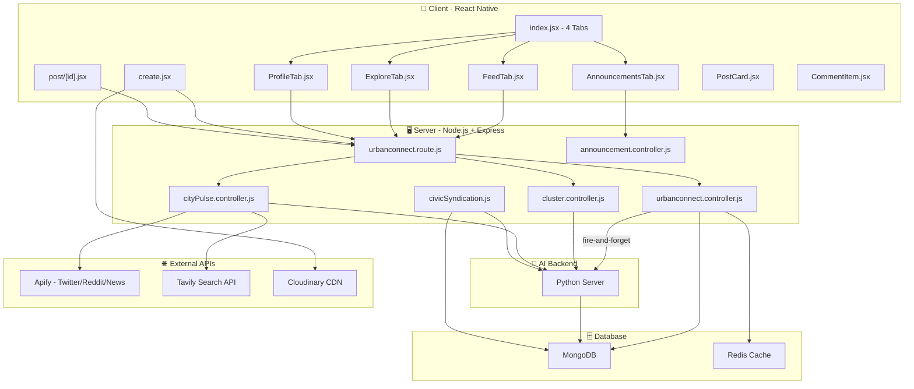
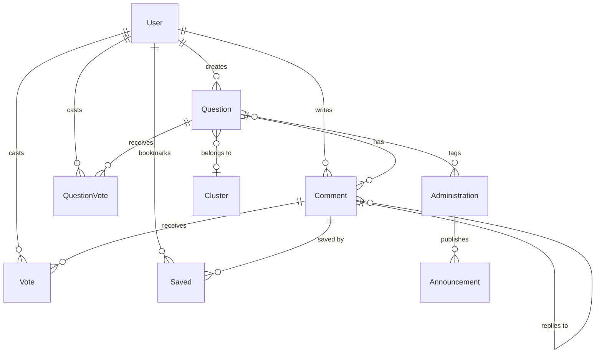

# UrbanConnect Walkthrough — Part 1: Architecture, Project Structure & Data Models

> **What is this?** This is the first of a 4-part deep dive into the **UrbanConnect** feature of the UrbanFlow platform. Read this from top to bottom — by the end you'll be able to explain the entire architecture, every file, and every data model in a technical interview.

---

## 1. What Is UrbanConnect?

UrbanConnect is a **real-time community discussion platform** — think of it like a city-specific Reddit/Twitter hybrid. Citizens can:

- **Post** about civic issues (water supply, corruption, roads, etc.)
- **Upvote/Downvote** posts and comments (Reddit-style)
- **Comment & Reply** in threaded conversations
- **Search** across posts
- **Save** individual comments for later
- **Tag local authorities** (e.g., "Municipal Commissioner, Prayagraj")
- **View official government announcements**
- **See AI-detected emerging issue clusters** (e.g., 12 people complaining about water supply → AI groups them into a "Water Crisis" cluster)
- **View a City Pulse** sentiment analysis dashboard scraped from Twitter/Reddit/News

**Key differentiator**: Every post goes through an **AI pipeline** (running on a separate Python server) that analyzes sentiment, urgency, misinformation, and tries to cluster similar posts together.

---

## 2. The Tech Stack

| Layer | Technology |
|---|---|
| **Mobile Client** | React Native + Expo Router (`client-native/`) |
| **Server** | Node.js + Express (`server/`) |
| **Database** | MongoDB (Mongoose ODM) |
| **Cache** | Redis (feed caching, 60s TTL) |
| **File Storage** | Cloudinary (image uploads) |
| **AI Backend** | Python server (Gemini/LLM for analysis) |
| **Scraping** | Apify (Twitter, Reddit, Google News) + Tavily API |
| **Auth** | Auth0 (via `useAuthStore`) |
| **Scheduling** | `node-cron` for daily jobs |

---

## 3. Project Structure — The Bird's-Eye View

Here's a visual map of **every UrbanConnect file** in the project, organized by layer:

```
UrbanFlow/
├── server/
│   └── src/
│       ├── models/urbanconnect/           ← 11 Mongoose schemas
│       │   ├── questionModel.js           ← The CENTRAL model (posts)
│       │   ├── userModel.js               ← User profiles
│       │   ├── commentModel.js            ← Comments & replies
│       │   ├── voteModel.js               ← Comment-level votes
│       │   ├── questionVoteModel.js        ← Post-level votes
│       │   ├── savedModel.js              ← Bookmarked comments
│       │   ├── administrationModel.js      ← Government authority entries
│       │   ├── announcementModel.js        ← Synthetic gov announcements
│       │   ├── clusterModel.js            ← AI-generated issue clusters
│       │   ├── socialPulseModel.js         ← City Pulse sentiment reports
│       │   └── ansModel.js                ← Legacy answer model (unused)
│       │
│       ├── controllers/
│       │   ├── urbanconnect.controller.js  ← MAIN controller (822 lines, 13 exports)
│       │   └── urbanconnect/
│       │       ├── cluster.controller.js   ← AI clustering logic
│       │       ├── cityPulse.controller.js ← Apify scraping + AI analysis
│       │       └── announcement.controller.js ← Announcements + RAG search
│       │
│       ├── routes/
│       │   ├── urbanconnect.route.js       ← All /api/urbanconnect/* routes
│       │   ├── announcement.routes.js      ← /api/announcements routes
│       │   └── cityPulse.routes.js         ← /api/city-pulse routes
│       │
│       ├── services/
│       │   ├── civicSyndication.js         ← CivicConnect → UrbanConnect bridge
│       │   └── syncReportStatus.js         ← Status sync for CivicConnect reports
│       │
│       └── utils/
│           └── cronJobs.js                ← Scheduled daily City Pulse job
│
└── client-native/
    └── app/(main)/(tabs)/urbanconnect/
        ├── _layout.jsx                    ← Stack navigator layout
        ├── index.jsx                      ← Main screen with 4 tabs + FAB
        ├── create.jsx                     ← Post creation modal
        ├── post/[id].jsx                  ← Post detail + reply screen
        └── components/
            ├── FeedTab.jsx                ← Infinite-scroll feed
            ├── ExploreTab.jsx             ← Search + AI clusters
            ├── ProfileTab.jsx             ← User profile (posts/likes/saved)
            ├── AnnouncementsTab.jsx        ← Government announcements
            ├── NotificationsTab.jsx        ← Push notifications (Zustand store)
            ├── PostCard.jsx               ← Reusable post component
            └── CommentItem.jsx            ← Recursive threaded comment
```

---

## 4. How the Pieces Connect — The Architecture Diagram



---

## 5. The Data Models — Line by Line

This section explains every Mongoose model. Understanding these is **critical** — interviewers love asking about schema design.

---

### 5.1 `questionModel.js` — The Heart of UrbanConnect

**File**: [questionModel.js](file:///e:/sankalp/UrbanFlow/server/src/models/urbanconnect/questionModel.js)

Despite the name "question", this is really a **post**. The naming is a legacy artifact. Every civic discussion, complaint, or CivicConnect report becomes a `Question` document.

#### Schema Breakdown

| Field | Type | Purpose |
|---|---|---|
| `author` | `ObjectId → User` | Who created the post. Required. |
| `title` | `String` | Post headline. Required. |
| `description` | `String` | Post body text. Required. |
| `image` | `[String]` | Array of Cloudinary image URLs. Default `[]`. |
| `tags` | `[String]` | Hashtags or category labels. |
| `taggedAuthorities` | `[ObjectId → Administration]` | Government officials tagged in the post. |
| `isAnswered` | `Boolean` | Legacy field (marks if an "answer" was provided). |
| `votes` | `Number` | Net vote count (upvotes minus downvotes). |

**Civic Syndication Fields** (added when a CivicConnect report is cross-posted):

| Field | Type | Purpose |
|---|---|---|
| `isCivicReport` | `Boolean` | `true` if this post originated from CivicConnect. |
| `reportId` | `String` | Original CivicConnect report ID. |
| `reportCategory` | `String` | Category like `water`, `waste`, etc. |
| `reportStatus` | `Enum` | `PENDING`, `ASSIGNED`, `USERVERIFICATION`, `RESOLVED`. |
| `geohash` | `String` | Location hash for geo queries. |

**AI Analysis Fields** (populated asynchronously by Python agent):

| Field | Type | Purpose |
|---|---|---|
| `aiAnalysis.sentiment` | `Enum` | `POSITIVE`, `NEUTRAL`, `NEGATIVE`, or `ALARMING`. |
| `aiAnalysis.sentimentScore` | `Number` | Numeric confidence (e.g., 0.85). |
| `aiAnalysis.urgency` | `Enum` | `LOW`, `MEDIUM`, `HIGH`, `CRITICAL`. |
| `aiAnalysis.postType` | `Enum` | `CIVIC_REPORT`, `POLICY_RUMOR`, or `GENERAL`. |
| `aiAnalysis.isMisinformation` | `Boolean` | `true` if AI flags potential misinformation. |
| `aiAnalysis.contextNote` | `String` | Human-readable fact-check note. |
| `aiAnalysis.clusterId` | `String` | ID of the cluster this post belongs to. |
| `aiAnalysis.analyzedAt` | `Date` | When the AI analysis was completed. |
| `embedding` | `[Number]` | 768-dim vector embedding for semantic search/clustering. |

**Indexes** (for query performance):
```javascript
questionSchema.index({ author: 1 });      // Fast lookup by author
questionSchema.index({ tags: 1 });         // Fast tag-based filtering
questionSchema.index({ votes: -1 });       // Hot/trending sort
```

**Interview Q: Why store `votes` directly on the Question instead of computing it?**
> Answer: Performance. Computing vote count by aggregating the `QuestionVote` collection every time a feed loads would be O(N) per post. Denormalizing it as a counter on the document makes feed queries O(1) for vote display. The trade-off is we must carefully maintain consistency — every vote operation uses `$inc` to atomically update this counter.

---

### 5.2 `userModel.js` — User Identity

**File**: [userModel.js](file:///e:/sankalp/UrbanFlow/server/src/models/urbanconnect/userModel.js)

Minimal user profile synced from Auth0.

| Field | Type | Purpose |
|---|---|---|
| `auth0Id` | `String (unique, sparse)` | Auth0 Subject ID. Sparse = allows null. |
| `username` | `String` | Display name. |
| `email` | `String (unique, lowercase)` | Primary identifier. Lowercase enforced at DB level. |
| `avatar` | `String` | Profile picture URL (from Auth0 or Cloudinary). |

**Interview Q: Why is `auth0Id` marked `sparse: true`?**
> Answer: The `sparse` option means MongoDB won't index documents where `auth0Id` is `null`. This allows multiple users to exist without an `auth0Id` (e.g., auto-bootstrapped users from CivicConnect syndication) without violating the unique constraint.

---

### 5.3 `commentModel.js` — Threaded Comments

**File**: [commentModel.js](file:///e:/sankalp/UrbanFlow/server/src/models/urbanconnect/commentModel.js)

Uses a **self-referential `parentId`** pattern for threaded replies. If `parentId` is `null`, it's a top-level comment. If `parentId` points to another Comment, it's a reply.

| Field | Type | Purpose |
|---|---|---|
| `questionId` | `ObjectId → Question` | Which post this comment belongs to. |
| `parentId` | `ObjectId → Comment` | `null` for top-level comments, set for replies. |
| `author` | `ObjectId → User` | Who wrote it. |
| `authorName` | `String` | Denormalized display name (avoids join). |
| `authorEmail` | `String` | Denormalized email. |
| `votes` | `Number` | Net upvotes/downvotes (denormalized counter). |
| `body` | `String` | Comment text. |
| `replyCount` | `Number` | How many direct replies this comment has. |

**Compound Index**:
```javascript
commentSchema.index({ questionId: 1, parentId: 1, _id: -1 });
```
This index serves the most common query: "Get all top-level comments for a question, sorted newest first."

**Interview Q: Why denormalize `authorName` and `authorEmail` on the comment?**
> Answer: Comments are read far more often than written. Without denormalization, every comment fetch requires a `$lookup` (join) to the User collection. Since usernames rarely change, storing them inline reduces query latency. The trade-off is that if a user renames themselves, old comments still show the old name.

---

### 5.4 `voteModel.js` — Comment Votes

**File**: [voteModel.js](file:///e:/sankalp/UrbanFlow/server/src/models/urbanconnect/voteModel.js)

Tracks individual user votes on comments (and optionally questions).

| Field | Type | Purpose |
|---|---|---|
| `userId` | `ObjectId → User` | Who voted. |
| `commentId` | `ObjectId → Comment` | Which comment (optional). |
| `questionId` | `ObjectId → Question` | Which question (optional). |
| `value` | `Number: -1 or 1` | Upvote (`1`) or downvote (`-1`). |

**Unique Indexes** (prevents double-voting):
```javascript
voteSchema.index({ userId: 1, commentId: 1 }, { unique: true, sparse: true });
voteSchema.index({ userId: 1, questionId: 1 }, { unique: true, sparse: true });
```

**Interview Q: Why not use a single model for both comment and question votes?**
> Answer: This actually IS a single model — `Vote` can track either a comment vote or a question vote depending on which field is populated. However, there's also a dedicated `QuestionVote` model (below) specifically for post-level votes, which was introduced later. The `Vote` model primarily handles comment-level voting, and its `questionId` field appears to be a legacy overlap.

---

### 5.5 `questionVoteModel.js` — Post-Level Votes

**File**: [questionVoteModel.js](file:///e:/sankalp/UrbanFlow/server/src/models/urbanconnect/questionVoteModel.js)

Dedicated to tracking upvotes/downvotes on questions (posts), separate from comment votes.

| Field | Type | Purpose |
|---|---|---|
| `userId` | `ObjectId → User` | Who voted. |
| `questionId` | `ObjectId → Question` | Which post. |
| `value` | `Number: -1 or 1` | Up or down. |

```javascript
questionVoteSchema.index({ userId: 1, questionId: 1 }, { unique: true });
```

This unique index is the **source of truth** for "has this user already voted on this post?" — it enforces one vote per user per question.

---

### 5.6 `savedModel.js` — Bookmarked Comments

**File**: [savedModel.js](file:///e:/sankalp/UrbanFlow/server/src/models/urbanconnect/savedModel.js)

Tracks which comments a user has bookmarked for later reference.

| Field | Type | Purpose |
|---|---|---|
| `userId` | `ObjectId → User` | Who saved it. |
| `commentId` | `ObjectId → Comment` | Which comment. |

The unique compound index `{ userId: 1, commentId: 1 }` prevents double-saving.

---

### 5.7 `administrationModel.js` — Government Authorities

**File**: [administrationModel.js](file:///e:/sankalp/UrbanFlow/server/src/models/urbanconnect/administrationModel.js)

Contains the directory of government officials and departments. Users can **tag** these when creating posts.

| Field | Type | Purpose |
|---|---|---|
| `city` | `String (indexed)` | E.g., "Prayagraj", "Delhi". |
| `postName` | `String` | Job title, e.g., "Municipal Commissioner". |
| `department` | `String` | E.g., "Civic", "Revenue", "Police". |

```javascript
administrationSchema.index({ city: 1, postName: 1 }, { unique: true });
```

**Interview Q: Why is this not just stored in the Question model?**
> Answer: Authorities are a **reference data** set — they exist independently of posts. Multiple posts can tag the same authority. By normalizing this into its own collection, we avoid data duplication and can update authority info in one place. Posts reference them via `taggedAuthorities: [ObjectId]`.

---

### 5.8 `announcementModel.js` — Official Government Announcements

**File**: [announcementModel.js](file:///e:/sankalp/UrbanFlow/server/src/models/urbanconnect/announcementModel.js)

Stores synthesized (seeded) government announcements, displayed in the Announcements tab.

| Field | Type | Purpose |
|---|---|---|
| `authority` | `ObjectId → Administration` | Which official made the announcement. |
| `title` | `String` | Announcement headline. |
| `body` | `String` | Full text. |
| `city` | `String (indexed)` | Target city. |
| `department` | `String` | Department tag. |
| `embedding` | `[Number]` | Vector embedding for RAG (semantic search). |
| `expiresAt` | `Date` | Auto-expiry via MongoDB TTL. |

**Key Indexes**:
```javascript
announcementSchema.index({ city: 1, createdAt: -1 });        // Feed query
announcementSchema.index({ expiresAt: 1 }, { expireAfterSeconds: 0 }); // TTL auto-delete
```

**Interview Q: What is the `embedding` field used for?**
> Answer: It stores a vector embedding (generated by an LLM) for semantic search. When the AI agent needs to fact-check a claim (Retrieval-Augmented Generation / RAG), it uses MongoDB Atlas Vector Search to find the most semantically similar announcements, rather than just keyword matching. This powers the misinformation detection pipeline.

---

### 5.9 `clusterModel.js` — AI Issue Clusters

**File**: [clusterModel.js](file:///e:/sankalp/UrbanFlow/server/src/models/urbanconnect/clusterModel.js)

When multiple posts about the same issue are detected (via cosine similarity), the AI groups them into a **cluster** and generates a summary.

| Field | Type | Purpose |
|---|---|---|
| `clusterId` | `String (unique)` | UUID-based identifier, e.g., `cluster_a3f2b190`. |
| `headline` | `String` | AI-generated headline, e.g., "Water Supply Crisis in Old City". |
| `summary` | `String` | AI-generated summary of all clustered posts. |

Displayed in the **Explore** tab as "Emerging Issues."

---

### 5.10 `socialPulseModel.js` — City Pulse Sentiment Reports

**File**: [socialPulseModel.js](file:///e:/sankalp/UrbanFlow/server/src/models/urbanconnect/socialPulseModel.js)

The most complex model. Stores the results of the **City Pulse** pipeline — a daily scrape and AI analysis of social media + news for a given city.

#### Sub-schemas:

**`extractedIssueSchema`** — An individual civic issue found in social media:

| Field | Type | Purpose |
|---|---|---|
| `title` | `String` | Issue headline. |
| `description` | `String` | Detail. |
| `category` | `Enum` | One of 9 categories: `WATER_SUPPLY`, `ELECTRICITY`, `ROADS_AND_INFRA`, `SANITATION_WASTE`, `PUBLIC_HEALTH`, `TRAFFIC_TRANSPORT`, `LAW_AND_ORDER`, `CORRUPTION_BUREAUCRACY`, `OTHER`. |
| `locations_mentioned` | `[String]` | Area names found in the text. |
| `severity_level` | `Enum` | `LOW`, `MEDIUM`, `HIGH`, `CRITICAL`. |
| `complaint_volume` | `Number` | Approximate number of posts about this issue. |
| `source_urls` | `[String]` | Links to original tweets/posts/articles. |

**`sentimentMetricsSchema`** — Aggregate public mood:

| Field | Type | Purpose |
|---|---|---|
| `public_trust_score` | `Number` | 0-100 scale of public trust in local government. |
| `primary_emotion` | `String` | E.g., "Frustrated", "Hopeful". |
| `top_target_authority` | `String` | Who the public is most unhappy with. |

**`trendAnalysisSchema`** — Comparison with previous pulse:

| Field | Type | Purpose |
|---|---|---|
| `direction` | `Enum` | `IMPROVING`, `DECLINING`, `STABLE`, `INSUFFICIENT_DATA`. |
| `trust_score_delta` | `Number` | Change from yesterday's trust score. |
| `insight` | `String` | AI-generated trend commentary. |

**Main `socialPulseSchema`**:

| Field | Type | Purpose |
|---|---|---|
| `city` | `String (indexed)` | Target city. |
| `executive_summary` | `String` | AI-generated 2-3 sentence overview. |
| `sentiment_metrics` | Sub-doc | See above. |
| `trend_analysis` | Sub-doc | See above. |
| `extracted_issues` | `[Sub-doc]` | Array of specific issues. |
| `recommended_actions` | `[String]` | AI-suggested actions for government. |

---

### 5.11 `ansModel.js` — Legacy Answer Model

**File**: [ansModel.js](file:///e:/sankalp/UrbanFlow/server/src/models/urbanconnect/ansModel.js)

A simple model for "answers" to questions. **Not actively used** in the current implementation — the system uses `Comment` instead. Likely a leftover from an earlier Q&A-style design.

| Field | Type | Purpose |
|---|---|---|
| `question` | `ObjectId → Question` | Which question it answers. |
| `body` | `String` | Answer text. |
| `author` | `ObjectId → User` | Who wrote it. |
| `votes` | `Number` | Vote count. |

---

## 6. Model Relationship Diagram



---

## 7. Key Design Patterns to Highlight in Interviews

### 7.1 Denormalization
- `votes` count stored on both `Question` and `Comment` instead of computing from vote collections
- `authorName` and `authorEmail` stored on comments instead of joining

### 7.2 Cursor-Based Pagination
- Uses `_id`-based cursors (`after` parameter) instead of `skip/limit`
- More efficient for large datasets — no offset scanning

### 7.3 Fire-and-Forget Pattern
- AI analysis runs asynchronously after response is sent to user
- `(async () => { ... })()` pattern for non-blocking background work

### 7.4 Cache Invalidation
- Redis cache with prefix `urbanconnect:questions:*`
- Invalidated on every write operation (create, vote, comment)
- 60-second TTL as safety net

### 7.5 TTL Index for Auto-Expiry
- Announcements auto-delete via MongoDB's native TTL index on `expiresAt`

---

> **Next**: [Part 2 — Server-Side Controllers, Services & API Endpoints](file:///e:/sankalp/UrbanFlow/urbanconnect_walkthrough_part2.md) covers every controller function, the AI pipeline, clustering algorithm, City Pulse scraping, and CivicConnect syndication.
