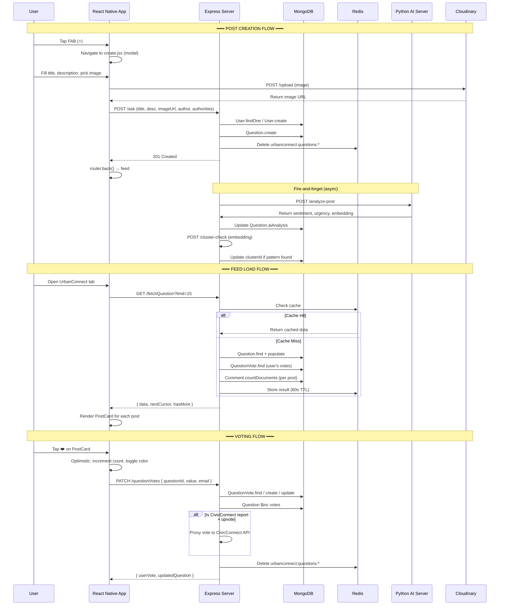

# UrbanConnect Walkthrough — Part 3: Client-Side Implementation & UI Components

> **Prerequisites**: Read [Part 1 (Models)](file:///e:/sankalp/UrbanFlow/urbanconnect_walkthrough_part1.md) and [Part 2 (Server)](file:///e:/sankalp/UrbanFlow/urbanconnect_walkthrough_part2.md) first.

---

## 1. Client Architecture Overview

The UrbanConnect mobile client is built with **React Native + Expo Router**. It lives inside the main UrbanFlow app as a **tab** within the tab navigator:

```
client-native/app/(main)/(tabs)/urbanconnect/
├── _layout.jsx          ← Stack Navigator config
├── index.jsx            ← Hub screen (contains 4 internal tabs + FAB)
├── create.jsx           ← Post creation modal
├── post/[id].jsx        ← Post detail + reply input
└── components/
    ├── FeedTab.jsx           ← Infinite-scroll post feed
    ├── ExploreTab.jsx        ← Search + AI clusters
    ├── ProfileTab.jsx        ← User's posts/likes/saved
    ├── AnnouncementsTab.jsx  ← Gov announcements feed
    ├── NotificationsTab.jsx  ← Push notifications
    ├── PostCard.jsx          ← Reusable post card UI
    └── CommentItem.jsx       ← Recursive threaded comment
```

**Shared dependencies** used by components:
- `useAuthStore` — Zustand store for Auth0 user data (name, email, picture, nickname)
- `api` — Axios instance with base URL configured (`lib/api.js`)

---

## 2. Navigation Flow — `_layout.jsx`

**File**: [_layout.jsx](file:///e:/sankalp/UrbanFlow/client-native/app/(main)/(tabs)/urbanconnect/_layout.jsx)

```jsx
<Stack screenOptions={{ headerShown: false, animation: 'slide_from_right' }}>
  <Stack.Screen name="index" />
  <Stack.Screen name="create" options={{ presentation: 'modal' }} />
  <Stack.Screen name="post/[id]" />
</Stack>
```

**What this does**:
- Configures a **Stack Navigator** (screens stack on top of each other)
- `headerShown: false` — all screens manage their own headers
- `animation: 'slide_from_right'` — iOS-style slide transition
- The `create` screen uses `presentation: 'modal'` — slides up from the bottom

**Navigation tree**:
```
index (hub with tabs) → create (modal)
                       → post/[id] (detail)
```

**Interview Q: Why use Stack inside a Tab?**
> The UrbanConnect tab needs its own internal navigation (hub → detail → create). Expo Router's nested `Stack` within a tab lets you push/pop screens without leaving the tab context.

---

## 3. The Hub Screen — `index.jsx`

**File**: [index.jsx](file:///e:/sankalp/UrbanFlow/client-native/app/(main)/(tabs)/urbanconnect/index.jsx)

This is the **main entry point**. It manages 4 internal "tabs" using simple `useState` (not another navigator):

```jsx
const [activeTab, setActiveTab] = useState('feed');

// Rendered conditionally:
{activeTab === 'feed' && <FeedTab />}
{activeTab === 'explore' && <ExploreTab />}
{activeTab === 'profile' && <ProfileTab />}
{activeTab === 'announcements' && <AnnouncementsTab />}
```

**Key UI elements**:

1. **Dynamic Header**: Shows the UrbanFlow logo + tab title (changes based on active tab)
2. **Tab Content Area**: Renders the active component
3. **Floating Action Button (FAB)**: Blue "+" button positioned above the bottom bar
   - Opens the `create` screen as a modal: `router.push('/(main)/(tabs)/urbanconnect/create')`
4. **Custom Bottom Tab Bar**: 4 icons — Home, Search, User, Megaphone
   - Uses Lucide React Native icons
   - Active state: white filled icon; inactive: gray outline

**Interview Q: Why render tabs with conditional rendering instead of a real Tab Navigator?**
> Simplicity and control. Using `useState` for tab switching is lighter than a nested Tab Navigator. Each tab component manages its own data fetching — when you switch tabs, React conditionally renders the component, triggering its `useEffect`. This avoids the complexity of nested Expo Router navigators.

---

## 4. The Feed — `FeedTab.jsx`

**File**: [FeedTab.jsx](file:///e:/sankalp/UrbanFlow/client-native/app/(main)/(tabs)/urbanconnect/components/FeedTab.jsx)

The core of the UrbanConnect experience — an infinite-scroll feed of community posts.

### Data Flow

```
FeedTab mounts
  → useEffect → fetchPosts()
  → GET /api/urbanconnect/fetchQuestion?limit=15
  → Response: { data: [...posts], nextCursor, hasMore }
  → setPosts(data), setNextCursor, setHasMore

User scrolls to bottom (onEndReached)
  → fetchPosts(true) // isLoadMore = true
  → GET /api/urbanconnect/fetchQuestion?limit=15&after={nextCursor}
  → Append new posts to existing list

User pulls to refresh (RefreshControl)
  → Reset cursor + hasMore
  → fetchPosts() // fresh load
```

### State Management

| State | Type | Purpose |
|---|---|---|
| `posts` | `array` | Current list of posts |
| `loading` | `boolean` | Initial load state |
| `refreshing` | `boolean` | Pull-to-refresh state |
| `loadingMore` | `boolean` | Infinite scroll loading state |
| `nextCursor` | `string` | MongoDB `_id` for cursor-based pagination |
| `hasMore` | `boolean` | Whether more posts exist |

### Skeleton Loading

While the initial data loads, 4 `SkeletonPost` components render gray placeholder blocks (shimmer effect approximation):

```jsx
{loading && !refreshing && posts.length === 0 ? (
  <ScrollView>
    {[1, 2, 3, 4].map(key => <SkeletonPost key={key} />)}
  </ScrollView>
) : (
  <FlatList ... />
)}
```

### Mock Data Fallback

If the API fails entirely, a single mock post is shown: "Welcome to UrbanConnect!"

---

## 5. Post Creation — `create.jsx`

**File**: [create.jsx](file:///e:/sankalp/UrbanFlow/client-native/app/(main)/(tabs)/urbanconnect/create.jsx)

Modal screen for creating new posts. Has a Twitter-like compose UI.

### Data Flow

```
User fills in title + description + (optional image) + (optional authorities)
  → handlePost()
  
1. If image selected:
   → FormData with image → POST /api/urbanconnect/upload
   → Receive Cloudinary URL
   
2. Create post:
   → POST /api/urbanconnect/ask
   → Body: { title, description, image: [url], author: user, taggedAuthorities: [...ids] }
   
3. router.back() → returns to feed
```

### Features

**Image Picker**: Uses `expo-image-picker` to select from device gallery:
```jsx
let result = await ImagePicker.launchImageLibraryAsync({
  mediaTypes: ImagePicker.MediaTypeOptions.Images,
  allowsEditing: true,
  aspect: [4, 3],
  quality: 0.8,
});
```

**Authority Tagging Modal**: A slide-up modal that lets you:
1. Type a city name (with 500ms debounce)
2. Fetches authorities: `GET /api/urbanconnect/authorities/{city}`
3. Tap to toggle-select officials
4. Selected authorities shown with blue border + checkmark

### State Variables

| State | Type | Purpose |
|---|---|---|
| `title` | `string` | Post title |
| `content` | `string` | Post body |
| `isPosting` | `boolean` | Submission in progress |
| `selectedImage` | `object` | Image picker result (URI, etc.) |
| `uploading` | `boolean` | Image upload in progress |
| `showAuthorityModal` | `boolean` | Modal visibility |
| `authorities` | `array` | Fetched authorities for city |
| `taggedAuthorities` | `array` | Selected authorities |
| `citySearch` | `string` | City search input |

---

## 6. Post Detail — `post/[id].jsx`

**File**: [post/[id].jsx](file:///e:/sankalp/UrbanFlow/client-native/app/(main)/(tabs)/urbanconnect/post/[id].jsx)

Dynamic route screen that shows a single post with all its comments and a reply input.

### Data Flow

```
Screen mounts with route param 'id'
  → useEffect → GET /api/urbanconnect/fetchQuestion/{id}
  → Response: { ...post, comments: [...] }
  → setPost(data)

User types reply and taps send
  → POST /api/urbanconnect/comment
  → Body: { questionId: id, authorName, authorEmail, comment: reply }
  → Optimistic UI: prepend new comment to state immediately
  → Clear reply input
```

### Key Concepts

- **`useLocalSearchParams()`**: Expo Router hook to read the `[id]` dynamic route parameter
- **Optimistic UI**: The comment is added to the local state immediately (with a random `_id`) before the API call completes. This makes the UI feel instant.
- **Fallback mock**: If the API fails, a hardcoded welcome post is shown to prevent crashes.

---

## 7. The PostCard Component — `PostCard.jsx`

**File**: [PostCard.jsx](file:///e:/sankalp/UrbanFlow/client-native/app/(main)/(tabs)/urbanconnect/components/PostCard.jsx)

The most-reused component in UrbanConnect. Every post in the feed, search results, and profile tabs renders through this.

### Visual Structure

```
┌───────────────────────────────────────────────┐
│ [Avatar]  AuthorName  @handle  · 2h    [···]  │
│                                                │
│           [CIVIC SYSTEM] [● ASSIGNED]          │  ← Only for civic reports
│                                                │
│           Post Title (bold)                    │
│           Post description text...             │
│                                                │
│           [@Municipal Commissioner · Prayagraj]│  ← Tagged authorities
│                                                │
│           [Image(s) - horizontal scroll]       │
│                                                │
│           ┌────────────────────────┐           │
│           │ ⚠ Community Context    │           │  ← Misinformation flag
│           │ This post may contain...│           │
│           └────────────────────────┘           │
│                                                │
│           💬 12    ❤️ 42                       │  ← Action bar
└───────────────────────────────────────────────┘
```

### Features by Section

**1. Header Row**: Author avatar (image or initial), name, handle, timeAgo, more button

**2. Civic Report Badges** (`isCivicReport === true`):
- "CIVIC SYSTEM" badge in cyan
- Status pill with live color coding:
  - `PENDING` → gray with gray dot
  - `ASSIGNED` → yellow with yellow dot
  - `USERVERIFICATION` → purple, displays as "IN REVIEW"
  - `RESOLVED` → green with green dot

**3. Tagged Authorities**: Blue chips showing `postName · city`

**4. Image Gallery**: Horizontal `ScrollView` with tappable images → full-screen modal on tap

**5. Misinformation Flag**: If `post.aiAnalysis.isMisinformation === true`, shows a red "Community Context" box with the AI's `contextNote`

**6. Action Bar**:
- 💬 Comment button → navigates to `post/[id].jsx`
- ❤️ Like button → `PATCH /api/urbanconnect/questionVotes` with **optimistic UI**:
  - Immediately updates count and color
  - API call fires in background
  - On failure, reverts the optimistic update

---

## 8. Threaded Comments — `CommentItem.jsx`

**File**: [CommentItem.jsx](file:///e:/sankalp/UrbanFlow/client-native/app/(main)/(tabs)/urbanconnect/components/CommentItem.jsx)

A **recursive component** that renders comments and their nested replies.

### Recursive Pattern

```jsx
// CommentItem receives depth prop
function CommentItem({ comment, depth = 0 }) {
  // ... renders comment content ...
  
  // If replies exist, render them:
  {showReplies && replies.map(reply => (
    <CommentItem key={reply._id} comment={reply} depth={depth + 1} />
  ))}
}
```

Each level increases `depth`, which:
- Increases `paddingLeft` (visual indentation)
- Reduces avatar size (40px → 32px for replies)
- Removes bottom border for replies

### Features

**Thread Voting** (Reddit-style):
- Upvote/Downvote buttons in a pill container
- `PATCH /api/urbanconnect/votes` with optimistic UI
- Toggle: clicking the same vote again sends `0` to remove it

**Inline Reply Box**: Tap "Reply" → reveals a `TextInput` below the comment
- On submit: `POST /api/urbanconnect/comment` with `parentId` set
- Optimistic UI: immediately appends temp reply to local state

**Bookmark**: Tap bookmark icon → `POST /api/urbanconnect/save`
- Toggle: yellow fill = saved, gray outline = unsaved
- Optimistic UI with rollback on failure

**Lazy Reply Loading**: Replies are loaded on demand:
```
User taps "Show 3 replies"
  → GET /api/urbanconnect/replies?parentId={commentId}&limit=10
  → Renders each reply as a nested CommentItem
```

---

## 9. Explore Tab — `ExploreTab.jsx`

**File**: [ExploreTab.jsx](file:///e:/sankalp/UrbanFlow/client-native/app/(main)/(tabs)/urbanconnect/components/ExploreTab.jsx)

Has two modes: **search** and **clusters**.

### When no search query (default view):

Displays **AI-detected emerging issue clusters**:

```
Data flow:
  → Mount → GET /api/urbanconnect/clusters
  → Response: { data: [{ clusterId, headline, summary, postCount, createdAt }] }
```

Each cluster card shows:
- Red "⚡ Emerging Issue" badge with index number
- AI-generated headline (bold)
- AI-generated summary
- Report count ("7 reports") with trending icon
- "View reports" action button

If no clusters exist: empty state with "No emerging issues detected" message.

### When search query is entered:

```
User types in search bar (500ms debounce)
  → POST /api/urbanconnect/search
  → Body: { search: "water supply" }
  → Response: [...matching posts]
  → Rendered as PostCard components
```

---

## 10. Profile Tab — `ProfileTab.jsx`

**File**: [ProfileTab.jsx](file:///e:/sankalp/UrbanFlow/client-native/app/(main)/(tabs)/urbanconnect/components/ProfileTab.jsx)

Full user profile with 3 sub-tabs: Posts, Likes, Saved.

### Data Flow

```
Mount → GET /api/urbanconnect/profile?email={user.email}&name={user.name}&...
Response: {
  posts: [...],    ← User's posts
  replies: [...],  ← User's comments (not displayed currently)
  likes: [...],    ← Posts the user upvoted
  saved: [...]     ← Bookmarked comments
}
```

### UI Structure

```
┌──────────────────────────────┐
│ [Cover Photo - Unsplash]     │
│ [User Avatar]                │
│  John Doe                    │
│  @johndoe                    │
│  📅 Joined March 2026       │
│                              │
│ [Posts] [Likes] [Saved]      │  ← Sub-tabs
│ ─────────  ───── ─────       │
│                              │
│  ... PostCard / SavedCard    │
└──────────────────────────────┘
```

**Posts tab**: Renders `PostCard` for each post
**Likes tab**: Renders `PostCard` for each liked post (pre-marked with `userVote: 1`)
**Saved tab**: Custom card showing saved comment with parent question context and bookmark icon

---

## 11. Announcements Tab — `AnnouncementsTab.jsx`

**File**: [AnnouncementsTab.jsx](file:///e:/sankalp/UrbanFlow/client-native/app/(main)/(tabs)/urbanconnect/components/AnnouncementsTab.jsx)

Read-only feed of official government announcements.

### Data Flow

```
Mount → GET /api/announcements?city=Prayagraj&limit=20
Response: { data: [{ _id, title, body, city, department, authorityName, createdAt }] }
```

### UI

- **Section Header**: "📢 Official Announcements — Prayagraj Administration" + count badge
- **Announcement Cards**: Custom card with:
  - Authority avatar (first letter) + name + "Prayagraj · Official"
  - Department color-coded badge (Revenue=yellow, Civic=blue, Emergency=red, Police=purple)
  - Title + body text
  - Green "Official Announcement" badge + time ago

---

## 12. Notifications Tab — `NotificationsTab.jsx`

**File**: [NotificationsTab.jsx](file:///e:/sankalp/UrbanFlow/client-native/app/(main)/(tabs)/urbanconnect/components/NotificationsTab.jsx)

Uses the **Zustand `useNotificationStore`** (not a back-end API) to display push notifications.

Each notification has:
- Type icon (Shield, Megaphone, Briefcase, Heart, Flame, Bell)
- Message text
- Time ago
- Unread indicator (blue dot)

Tapping marks the notification as read.

> Note: This component currently reads from a local Zustand store, not an API. Notifications are pushed via other features in the UrbanFlow app.

---

## 13. Complete Client Data Flow Summary



---

> **Next**: [Part 4 — Interview Q&A](file:///e:/sankalp/UrbanFlow/urbanconnect_walkthrough_part4.md) — 30+ interview questions and answers covering architecture, design decisions, scalability, security, and trade-offs.
